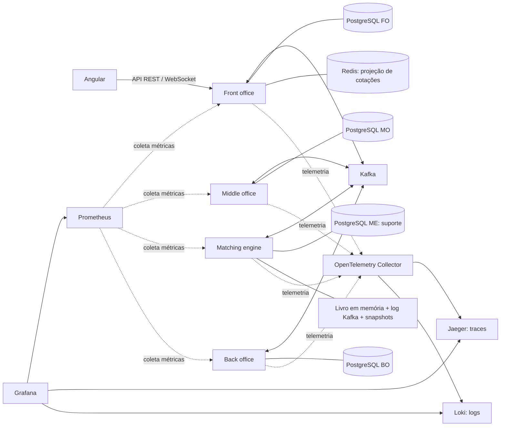

# Próspero — Escopo, arquitetura e requisitos

## Objetivo e estado atual

Próspero é um simulador local de mercado financeiro com cinco ações fictícias. Seu objetivo de estudo é explicar formação de preços e acompanhar uma ordem desde o envio até o risco, matching, registro contábil e liquidação simulada em D+2. Não movimenta dinheiro real nem se integra a bolsas.

A P02 cria a fundação: quatro aplicações Quarkus/Java 26, Angular, bancos isolados, mensageria e observabilidade em containers. Os endpoints iniciais informam identidade e saúde técnica. **Negociação, risco, posições e liquidação ainda serão implementados.** Consulte o [roadmap global](docs/roadmap.md) e os roadmaps de [front office](front-office/ROADMAP.md), [middle office](middle-office/ROADMAP.md), [matching](matching-engine/ROADMAP.md), [back office](back-office/ROADMAP.md) e [Angular](frontend/ROADMAP.md).

## Escopo funcional

O investidor poderá acompanhar cotação, spread, profundidade, execuções, posição e lucro/prejuízo; enviar ordens Market, Limit, Stop e Stop Limit, com validade Dia, IOC ou FOK, e vincular Stop Loss/Take Profit em OCO. Participantes simulados fornecerão ofertas. Haverá risco prévio, reservas, execuções parciais, cancelamento de saldo, razão em partidas dobradas e liquidação D+2.

Estão fora do escopo dados reais, múltiplas bolsas, FIX/UMDF, leilões, circuit breaker de bolsa, iceberg, corretagem, impostos e aluguel real de ações. Venda a descoberto será simulada com limites. O projeto roda localmente e não contrata serviços pagos.

## Arquitetura

O diagrama mostra o destino arquitetural; fluxo financeiro e WebSocket ainda não existem. Na fundação, o Nginx do frontend encaminha consultas técnicas aos quatro serviços. A aplicação de negócio usará o FO como entrada, sem transformar o Angular em orquestrador da negociação.

| Componente | Responsabilidade |
| --- | --- |
| Front office | Receber ordens, persistir sua trajetória, orquestrar SAGA e expor dados ao investidor. |
| Middle office | Validar ordens e limites e reservar/liberar recursos atomicamente. |
| Matching engine | Executar ordens em sequência por ativo, com prioridade preço-tempo e replay determinístico. |
| Back office | Registrar negócios e razão, calcular posições e resultados e simular D+2. |
| Angular | Apresentar operações e estados; hospedar o módulo CLI de testes por planilha. |

Cada microsserviço possui build, imagem, migrações, credenciais e container PostgreSQL próprios. Os demais não acessam seu banco nem sua implementação. A colaboração de negócio ocorre via Kafka; a disponibilidade de todos não é exigida para iniciar cada processo, mas o fluxo ponta a ponta depende de seus participantes.

REST chama Actor; Actor coordena domínio/Helpers puros e repositórios JPA separados. O domínio não conhece HTTP, Quarkus ou JPA. SAGA, outbox e consumidores idempotentes coordenarão o fluxo distribuído. O livro permanece em memória, sem consultar banco por ordem. DDD e Object Calisthenics seguem os [ADRs](docs/adrs/README.md).

## Requisitos funcionais

| ID | Requisito e resultado esperado |
| --- | --- |
| RF01 | Listar ativos e exibir último preço, variação, bid/ask, spread, volume, cinco níveis por lado e profundidade agregada. |
| RF02 | Enviar compras/vendas Market, Limit, Stop e Stop Limit, validades Dia/IOC/FOK e proteção Stop Loss/Take Profit em OCO. |
| RF03 | Rejeitar lote/tick inválidos, Stop Limit sem limite e preços fora do túnel de ±10% da referência. |
| RF04 | Verificar poder de compra, posição, exposição vendida e quantidade máxima; reservar recursos antes do matching. |
| RF05 | Aplicar preço-tempo, preço da oferta passiva, parciais/totais, gatilhos de stops e cancelamento do saldo OCO. |
| RF06 | Atualizar último preço, bid/ask e VWAP por negócio; refletir também mudanças de ofertas sem execução. |
| RF07 | Calcular posição comprada/vendida, preço médio e resultados realizados/não realizados. |
| RF08 | Registrar negócios, razão em partidas dobradas e histórico; liquidar caixa e custódia em D+2 simulado. |
| RF09 | Exibir estados em tempo real e a linha do tempo da ordem pelos quatro serviços. |
| RF10 | Cancelar saldo elegível de Limit ou stop não acionado e liberar a reserva correta. |

Os cinco ativos, calendários, estados detalhados, escalas, arredondamento, reservas por tipo e casos de corrida serão definidos antes das tarefas que os implementam. O roadmap registra essas dependências; não são funcionalidades presumidas.

## Requisitos não funcionais

| ID | Garantia e critério de aceite |
| --- | --- |
| RNF01 | Precisão: nenhum `double` em dinheiro, preço ou quantidade; objetos de valor, escalas e verificação automatizada. |
| RNF02 | Determinismo: mesma sequência produz mesmos negócios; replay pelo Kafka. |
| RNF03 | Ordenação: escritor único e processamento sequencial por ativo. |
| RNF04 | Latência local: p99 boleta → negócio < 50 ms e matching < 1 ms/ordem, sob carga e ambiente documentados. |
| RNF05 | Reservas: nenhuma ordem admitida ao matching sem reserva; falhas tratadas sem perder recursos. |
| RNF06 | Idempotência: reentregas não duplicam negócios, lançamentos ou posições. |
| RNF07 | Observabilidade: trace por ordem, logs correlacionados, métricas e quatro dashboards de negócio. |
| RNF08 | Execução local reproduzível em Docker Compose, sem infraestrutura paga. |

As metas não estão comprovadas pela simples inicialização dos containers. A P02 valida a infraestrutura; a V01 mede o sistema financeiro integrado. O dashboard inicial cobre somente a fundação. Traces do Jaeger usam memória nesta etapa e não sobrevivem a reinícios; bancos, Kafka, Redis, Loki, Prometheus e Grafana usam volumes persistentes.

## Contratos, testes e entregas

APIs de negócio usam `/api/v1`, DTOs, OpenAPI/Swagger e códigos HTTP conforme seu resultado. `202` aceita processamento e não confirma execução; `204` não contém JSON. Endpoints técnicos do Quarkus mantêm seus caminhos próprios.

O runner `.xlsx`, previsto na P03, ficará no projeto Angular. Carga, passos e resultados esperados usarão somente APIs, com cenários independentes. Testes internos complementam invariantes, arquitetura e infraestrutura; consulte a elegibilidade no [ADR-004](docs/adrs/ADR-004-testes-planilha.md).

Uma tarefa global corresponde a uma branch e um PR com alterações, motivos, trade-offs e validação. O [README](README.md) contém os comandos reais para build, execução e verificação; [rules](docs/rules.md) é o contrato canônico e [libs](docs/libs.md) registra versões e adoção. O ai-memory está instalado e validado por CLI; a captura automática depende da confiança manual nos hooks (docs/memoria.md); o status das tarefas fica no [roadmap](docs/roadmap.md). Não há arquivo paralelo de continuidade.
