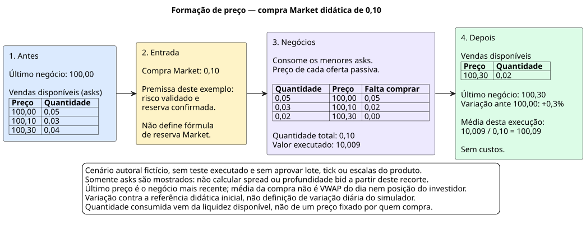
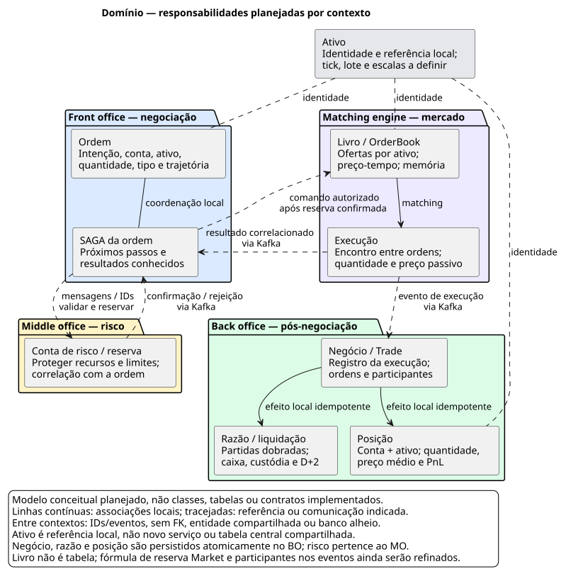

# Próspero

Simulador local de mercado financeiro com cinco ações fictícias, livro de ofertas, risco, execução, posições e liquidação simulada em D+2. Projeto de estudo, sem serviços pagos ou integração com bolsas reais.

## Estado atual

A fundação contém quatro microsserviços Quarkus/Java 26, Angular e Docker Compose. Cada serviço expõe identidade técnica, saúde, OpenAPI e métricas. O painel inicial consulta identidade e prontidão reais. **Negociação, risco e liquidação ainda não foram implementados.** Estado e PRs de entrega estão no [roadmap](docs/roadmap.md).

## Escopo do simulador

O **produto planejado** é um pequeno mercado de cinco ações fictícias, com um livro de ofertas por ativo, alimentado por formadores de mercado simulados e pelo investidor. A experiência permitirá acompanhar preço, melhor compra (bid), melhor venda (ask), spread e profundidade; enviar ordens Market, Limit, Stop e Stop Limit, com Stop Loss e Take Profit opcionais; observar execuções parciais/totais, posição comprada/vendida, preço médio e lucro/prejuízo (PnL) realizado/não realizado.

A ordem nasce no front office, passa por validação e risco no middle office, encontra contraparte no matching engine e gera negócios registrados pelo back office. O BO mantém histórico, razão em partidas dobradas, posição e liquidação simulada em D+2. O objetivo é explicar **como o preço emerge do encontro entre ordens** e como manter recursos consistentes quando mensagens atrasam, processos caem ou eventos se repetem. Os requisitos completos permanecem no [PRD](docs/prds/PRD-001-simulador-prospero.md).

### Fidelidade × simplificação

| Aspecto | Tratamento no Próspero |
| --- | --- |
| Mercado | Cinco ativos fictícios; sem dados reais, múltiplas bolsas ou roteamento inteligente entre bolsas. |
| Formação de preço | Prioridade preço-tempo, preço da oferta passiva e execução parcial; sem leilões de abertura/fechamento, iceberg ou circuit breaker de bolsa. |
| Stops | Acionamento no matching engine como simplificação; não há OMS separado de corretora. |
| Venda a descoberto | Simulada com limites; sem aluguel real de ações. |
| Custos | Sem corretagem, emolumentos ou impostos. |
| Liquidação | Caixa/custódia e D+2 simulados; sem câmara externa real. Calendário e feriados ainda serão definidos. |
| Integração | Eventos internos e APIs locais; sem FIX ou UMDF. |
| Precisão | Sem double financeiro; lote, tick, escalas e arredondamento precisam de definição antes dos cálculos de produto. |

## Conceitos de mercado na prática

| Conceito | Significado no simulador |
| --- | --- |
| Livro, bid e ask | Livro reúne ofertas em aberto por ativo. Melhor bid é a maior compra; melhor ask é a menor venda. O último negócio pode diferir dos dois. |
| Spread | Diferença entre melhor ask e melhor bid, quando ambos existem; não confundir spread com variação do último preço. |
| Profundidade e liquidez | Quantidade disponível em cada nível e acumulada; pouca oferta nos melhores preços permite que uma ordem consuma vários níveis. |
| Market e Limit | Market busca execução na liquidez disponível, sujeita aos limites definidos no contrato; Limit fixa o preço máximo de compra ou mínimo de venda e pode deixar saldo em aberto conforme validade. |
| Stop e Stop Limit | Gatilho condiciona a entrada da ordem; Stop é associado a execução a mercado e Stop Limit a uma ordem limitada. Referência de acionamento, igualdade, cascatas e combinações serão refinadas na RF05. |
| Stop Loss, Take Profit e OCO | Proteções vinculadas; execução de uma perna afeta a elegibilidade da outra. Ativação, parciais e corridas de cancelamento precisam de regra explícita. |
| Dia, IOC e FOK | Dia vale na sessão definida; IOC executa o disponível e cancela o saldo; FOK exige execução integral elegível ou nenhuma. Sessão, compatibilidade e concorrência ainda serão refinadas. |
| Execução parcial e total | Uma ordem pode gerar vários negócios. Quantidade enviada, executada, cancelada e saldo precisam se conservar, sem contar reentrega como negócio novo. |
| Long, short e PnL | Posição positiva é comprada; negativa é vendida. Redução realiza resultado; exposição remanescente tem resultado não realizado conforme cotação válida e regra de marcação. |

### Impacto de mercado: uma ordem pequena atravessa o livro

No exemplo abaixo, o último negócio inicial é `100,00`. Uma compra Market de `0,10` consome `0,05` a `100,00`, `0,03` a `100,10` e `0,02` a `100,30`. O último negócio passa a `100,30`, variação de `+0,3%` contra aquela referência; a **média desta execução** é `100,09`. O efeito vem da profundidade disponível, não do tamanho absoluto da ordem.



Valores e quantidades são fictícios, sem custos, apenas para explicar a mecânica. Não aprovam tick/lote/escala nem representam teste executado. O recorte omite bids: não permite calcular spread. A média dos três negócios desta compra também não é o VWAP do dia da RF06 nem o preço médio total da posição do investidor.

## Arquitetura dos microsserviços e bancos

Cada microsserviço tem build, credenciais, migrações e PostgreSQL próprios. As linhas do desenho representam a **fundação configurada**: proxy técnico do frontend, acesso ao próprio banco e saúde do Kafka. O livro de ofertas e as tabelas financeiras ainda não existem.


No desenho de negócio **planejado**, FO recebe ordens e orquestra a SAGA; MO valida e reserva recursos; ME executa por prioridade preço-tempo; BO registra negócios, razão, posições e D+2. A colaboração ocorre por Kafka, sem HTTP ou acesso a banco entre microsserviços. O livro do ME ficará em memória, com log e snapshots; seu PostgreSQL será de suporte, sem consulta por ordem.

### Responsabilidades de domínio

O modelo abaixo relaciona conceitos do desenho **planejado**, sem declarar classes, tabelas ou contratos já implementados. IDs e eventos ligam os contextos; referências a ativo não criam serviço central, entidade compartilhada ou FK entre bancos. A execução produzida pelo ME é registrada oficialmente no BO, onde negócio, razão e posição terão efeitos locais atômicos.



| Contexto | Fonte de verdade e invariantes de destino |
| --- | --- |
| Front office | Intenção/estado da ordem e coordenação da SAGA; não confirma execução só por aceitar o envio. |
| Middle office | Risco e recursos reservados; nenhuma admissão ao matching sem reserva confirmada ou uso concorrente indevido do mesmo recurso. |
| Matching engine | Sequência do livro por ativo e resultado das execuções; não decide saldo do investidor nem consulta JPA por ordem. |
| Back office | Negócios, razão, posição e liquidação; reentrega não repete efeitos e correções preservam histórico. |

### Organização técnica do backend

Os serviços são projetos independentes. O padrão por funcionalidade evita uma camada global que misture todos os domínios:

```text
br.prospero.<contexto>.<funcionalidade>/
  rest/      # DTO, HTTP, validação estrutural e chamada ao Actor
  actor/     # coordenação do caso de uso e transação local
  dominio/   # regras, entidades de domínio e objetos de valor
  helper/    # cálculo/transformação pura, sem estado ou I/O
  dto/       # contrato de entrada/saída; não é entidade JPA
  jpa/       # representação persistida e repositórios do contexto
```

Essa é a convenção; pacotes vazios não são funcionalidades prontas. Hoje, a identidade técnica já percorre `SistemaResource` → `ConsultarSistemaActor` → `SistemaResponseDTO`; o MO também contém o núcleo decimal puro. Adaptadores Kafka de negócio ainda serão implementados e chamarão os casos de uso sem passar por HTTP.

| Fronteira técnica | Regra e evidência esperada |
| --- | --- |
| API | `/api/v1`, DTOs, OpenAPI e Problem Details. Criação/aceitação e execução financeira são resultados distintos; `201`/`202` não concluem SAGA. |
| Domínio | Sem dependências Quarkus, HTTP, JPA ou rede. Dinheiro/quantidade/preço exigem invariantes e precisão explícitas, sem arredondamento silencioso. |
| Persistência | Migração e transação pertencem ao banco do próprio serviço. Estado + intenção recuperável devem sobreviver à janela de falha da publicação. |
| Consumidor | Identificar mensagem/efeito, deduplicar atomicamente e confirmar consumo segundo contrato; reprocessar não pode repetir efeitos. |
| Verificação | ArchUnit já restringe dependências entre contextos, REST→JPA e infraestrutura no domínio/Helpers, e campos double/Double no domínio. Isso não comprova cálculos financeiros ainda ausentes. |

Contratos, Object Calisthenics e exceções ficam nos [ADRs](docs/adrs/README.md); verificações proporcionais e segurança no [guia de desenvolvimento](docs/playbook-desenvolvimento.md). Não criar camadas/interfaces vazias nem compartilhar implementação por antecipação.

## Kafka, tópicos, consumidores e falhas

**Configuração atual:** Kafka 4.1.0, um nó KRaft com papéis broker/controller. Clientes usam `kafka:9092` e o controller usa `9093`, ambos PLAINTEXT na rede local; Kafka não publica porta no host. A criação automática de tópicos está desativada. Os fatores de replicação dos tópicos internos e o mínimo de réplicas da transação estão em 1; dados ficam no volume `kafka-dados`. Nó único e volume não fornecem failover ou backup.

Os quatro serviços configuram bootstrap e verificação de saúde. **Não há provisionamento de tópicos nem grupos/produtores/consumidores financeiros no código.** Estes nomes vêm do catálogo histórico do HLD e são candidatos, não contratos aprovados:

| Tópico candidato | Chave sugerida | Objetivo de destino |
| --- | --- | --- |
| `ordens.comandos` | Ativo | Sequenciar comandos autorizados para matching. |
| `mercado.negocios` | Ativo | Distribuir execuções para registro e outros efeitos de negócio. |
| `posicoes.eventos` | Conta | Distribuir mudanças de posição; passagem de ordem por ativo para conta a definir. |
| `mercado.precos` | A definir | Alimentar projeções de cotações; assinantes e chave ainda a definir. |

A organização pretendida separa responsabilidades: FO recebe resultados e acompanha a SAGA; MO trata validação/reserva e liberação; ME processa comandos com um escritor por ativo; BO registra execuções e calcula posições. IDs de grupos, partições, assinaturas, schemas, retenção, commits de offsets, concorrência, retries e tratamento de mensagens inválidas serão definidos antes da implementação. O grupo deve preservar um proprietário por partição/livro; não há ordem global entre tópicos.


A figura **simula conceitualmente** três falhas, sem executar interrupções: publicação indisponível mantém intenção recuperável; queda do BO após commit exige reentrega sem repetir efeitos; publicação abortada no ME exige alinhar memória, log, snapshot e offsets. A retomada depende de dados retidos e mecanismos ainda a implementar/testar. Transação Kafka não reverte o livro em memória nem abrange PostgreSQL. Fontes: [Compose](docker-compose.yml), [configuração dos serviços](front-office/src/main/resources/application.properties), [HLD](docs/hlds/HLD-001-arquitetura-prospero.md) e [limites de entrega do Kafka](https://kafka.apache.org/41/design/design/).

## SAGA e consistência em caso de erro

A SAGA será **orquestrada pelo FO**, com estado e próximos passos persistidos. O desenho usa transações locais, outbox para publicação recuperável e deduplicação atômica com os efeitos. Essas responsabilidades estão decididas no ADR-002; os componentes, estados e contratos ainda não estão implementados. As setas entre serviços abaixo representam mensagens lógicas via Kafka.


A consistência pretendida depende destas invariantes e dos testes de falha correspondentes:

- Matching só admite ordem com reserva confirmada; concorrência não pode reservar o mesmo recurso duas vezes.
- Rejeição conhecida antes da reserva encerra sem liberar algo que não foi reservado. Encerramento definitivo permite compensar apenas a parte elegível, de forma idempotente.
- Timeout ou queda com resultado desconhecido mantém pendência e exige reconciliação; **não libera reserva automaticamente**.
- Negócio já efetivado se recupera para frente até contabilizar; não é apagado para compensar uma falha posterior. Parciais e corridas de cancelamento exigem contratos próprios.
- Reentrega não duplica reserva, negócio, lançamento ou posição. Atomicidade é local e consistência entre contextos é eventual, sem commit global nem exactly-once geral.

Isso descreve como a consistência deverá ser construída e verificada, não uma garantia já comprovada. Fontes: [ADR-002](docs/adrs/ADR-002-padroes-dominio.md) e [HLDs dos serviços](docs/hlds/README.md).

## Observabilidade e indicadores

Os serviços enviam logs/traces por OTLP ao Collector; ele encaminha traces ao Jaeger e logs ao Loki. Prometheus coleta **diretamente** `/q/metrics` das quatro aplicações a cada 15 segundos; o Collector não possui pipeline de métricas. Grafana consulta as três fontes. A retenção Prometheus é de três dias; Jaeger usa memória e perde traces no reinício.


| Área | Indicadores a acompanhar | Estado |
| --- | --- | --- |
| Coleta técnica | `up{job="prospero"}` por serviço | Consulta do dashboard atual; sucesso de scrape não comprova prontidão financeira. |
| HTTP/JVM e recursos | Vazão, erros, latência, heap/GC, CPU, memória, disco/rede e pools | Endpoint técnico configurado; inventariar séries, coletores necessários e painéis na P06. |
| Kafka e publicação | Lag, idade do backlog/outbox, falhas e reentregas | Planejado; depende dos consumidores/publicadores e fontes de métricas. |
| SAGA e risco | Ordens pendentes/rejeitadas, tempo por etapa, reservas e compensações | Planejado nas RFs; controlar duplicação e recursos sem resolução. |
| Matching | Tempo de processamento e boleta até negócio; sequência/replay | Planejado; RNF04 exige p99 boleta→negócio < 50 ms e matching < 1 ms/ordem em cenário documentado. |
| Back office | Duplicações evitadas, conciliação de caixa/custódia, razão e liquidações pendentes | Planejado; medir invariantes e recuperação nas RF07/RF08. |
| Mercado e trajetória | Idade/ausência da cotação e trace da ordem nos quatro serviços | Planejado; quatro dashboards de negócio e alertas na V01. |

Ausência de série aparece como ausente, não zero. IDs de conta/ordem/execução ficam na correlação sanitizada de logs/traces, sem labels de alta cardinalidade nem segredos. Metas futuras exigem medições; configuração não comprova desempenho. Fontes: [Collector](infra/otel/collector.yaml), [Prometheus](infra/prometheus/prometheus.yml), [dashboard atual](infra/grafana/dashboards/fundacao.json) e [roadmap](docs/roadmap.md). Fontes editáveis e critérios das figuras: [catálogo de diagramas](docs/c4/README.md).

## Decisões técnicas e cenários de domínio

As explicações abaixo descrevem o destino e seus trade-offs. Não são relato de negociação ou testes financeiros já executados.

<details>
<summary>Escritor único por ativo e determinismo</summary>

Prioridade preço-tempo depende da sequência de comandos. Um escritor por livro evita escritores concorrentes naquele estado; ativos distintos podem ter processamento paralelo. Isso não elimina corridas de reservas, cancelamento, rebalanceamento ou publicação. Replay reproduz negócios somente se sequência, relógio, desempates, IDs e recuperação forem controlados; a meta de latência exige medição própria. Ativo quente ainda limita a capacidade da sua sequência.

</details>

<details>
<summary>Reentrega Kafka e negócio contado uma única vez</summary>

O desenho exige identidade estável do evento/negócio e deduplicação na mesma transação que grava negócio, razão e posição. Uma inserção condicional, como ON CONFLICT quando aplicável, só protege o fluxo se efeitos dependerem da inserção e todos forem atômicos; ignorar conflito e atualizar posição novamente continuaria incorreto. A composição exata do ID e o esquema serão definidos nas RFs. Produtor idempotente ou transação Kafka não estendem a garantia automaticamente ao banco ou livro em memória.

</details>

<details>
<summary>Risco aprovado com matching indisponível ou validade expirada</summary>

A publicação/entrega deve ser recuperável e a ordem deve permanecer com pendência explícita. Retomar exige log retido, offsets coerentes e reconstrução consistente do livro. O nome exato do estado público ainda depende do contrato; não presumir estado “enviada” como já implementado. Expiração Dia, timeout ou pedido de cancelamento não provam ausência de execução: reconciliar a corrida e liberar apenas saldo elegível com resultado conhecido.

</details>

<details>
<summary>Reserva antes do matching e proteção de ordens Market</summary>

Sem proteção atômica, duas ordens podem usar o mesmo recurso disponível. O MO deve reservar antes da admissão ao matching e ajustar consumo/liberação após resultados conhecidos. A fórmula por tipo ainda será definida na RF04: quantidade × preço limite é uma referência didática para Limit, mas não encerra regras de exposição, parciais e sinal. Market precisa de proteção de preço/risco explícita; usar último preço mais túnel como pior preço não é política aprovada nem uma garantia de execução. Stops e short também exigem tratamento próprio.

</details>

<details>
<summary>PostgreSQL, Redis e persistência do livro</summary>

Saldo/reserva e razão precisam de transações locais que preservem invariantes; projeções de cotação podem tolerar atraso declarado. PostgreSQL mantém os dados transacionais dos contextos proprietários; o livro do ME deriva do log Kafka e snapshots, com PostgreSQL apenas de suporte. Redis é destinado à projeção de cotações do FO, sem autoridade de risco. Chamar os usos de “CP” e “AP” é simplificação: comportamento sob partição precisa ser definido por operação, e Redis/Kafka únicos não dão HA. Livro em memória, log e snapshots exigem protocolo de recuperação; o PostgreSQL do ME não substitui o log no caminho crítico.

</details>

<details>
<summary>Preço médio, redução e virada de long para short</summary>

O comportamento pretendido distingue aumento, redução e abertura do lado oposto. Aumento recalcula média ponderada; redução realiza PnL contra a média anterior; ao cruzar zero, a sobra abre o novo lado pelo preço da execução. Escalas, arredondamento e detalhes da virada ainda serão fixados na RF07. Dois cenários **independentes**, ambos partindo de long 10 a preço médio 100, ilustram a regra, sem custos:

| Operação ilustrativa | Resultado realizado | Posição restante |
| --- | --- | --- |
| Vender 4 a 110 | 4 × (110 − 100) = 40 | Long 6, preço médio 100. |
| Vender 15 a 110 | 10 × (110 − 100) = 100 | Short 5, preço médio 110; o resultado futuro desse novo lado depende da cotação/fechamento. |

PnL não realizado é marcação da exposição ainda aberta; não é caixa liquidado. Negociação e liquidação são etapas diferentes, com reconciliação de caixa/custódia em D+2 conforme calendário a definir.

</details>

<details>
<summary>Ordem pequena, impacto, slippage e preço médio da execução</summary>

No exemplo do livro, 0,10 consome três níveis porque há pouca quantidade nos melhores asks. O último negócio fica em 100,30, mas a média da compra é 100,09; comparar ambos explica impacto e diferença entre referência e preço efetivamente obtido. Esses números dependem dos níveis fornecidos, não representam propriedade universal de uma ordem de 0,10. A referência usada para medir slippage deve ser explícita.

</details>

<details>
<summary>Triagem de incidente com métricas, traces e logs</summary>

Hoje o painel provisionado informa coleta técnica por up. No fluxo futuro, iniciar por vazão/ordens por estado e motivo, tempo por etapa e lag/backlog para localizar a espera; então seguir a trajetória de uma ordem no Jaeger e os logs correlacionados no Loki. Distinguir rejeição de negócio, erro de transporte, saturação do gerador e espera legítima por contraparte. Não inventar valor zero para uma série ausente nem assumir que os dashboards financeiros já existem.

</details>

<details>
<summary>Estratégia de testes do matching e recuperação</summary>

A RF05 deverá cobrir prioridade, preço passivo, parciais, IOC/FOK, stops/cascatas e OCO com exemplos e propriedades. Ao final de processamento elegível, livro ativo com ambos os lados não pode permanecer cruzado; quantidade se conserva e o mesmo log controlado reproduz os mesmos negócios. Concorrência, publicação abortada, retomada e cancelamento exigem testes específicos, além de cenários via API/planilha. jqwik/Testcontainers são alternativas citadas na referência, não bibliotecas adotadas automaticamente. O matching ainda não existe: não há suíte financeira executada a anunciar.

</details>

## Subir o ambiente

Pré-requisitos: Docker Engine com Compose v2 e Python 3. A máquina deve comportar os containers e a compilação; builds sequenciais reduzem o pico de memória. JDK e Node são instalados nas imagens, sem precisar alterar o Java do host.

```bash
python3 scripts/preparar-ambiente.py
docker compose config --quiet
COMPOSE_PARALLEL_LIMIT=1 docker compose build
docker compose up -d --wait --wait-timeout 240
python3 scripts/verificar-ambiente.py
```

O primeiro comando cria `.env` com credenciais aleatórias sem sobrescrever arquivo existente. As portas são exclusivas deste projeto e ficam publicadas somente em `127.0.0.1`. Nenhum banco, Kafka ou Redis é exposto ao host. Os nomes técnicos usam `prospero`, sem acento.

| Componente | Endereço local |
| --- | --- |
| Angular | http://localhost:4200 |
| Front office | http://localhost:8081/q/swagger-ui/ |
| Middle office | http://localhost:8082/q/swagger-ui/ |
| Matching engine | http://localhost:8083/q/swagger-ui/ |
| Back office | http://localhost:8084/q/swagger-ui/ |
| Grafana | http://localhost:13000 |
| Prometheus | http://localhost:19090 |
| Jaeger | http://localhost:16687 |
| Loki — prontidão | http://localhost:13100/ready |
| OpenTelemetry Collector — saúde | http://localhost:14333 |

Grafana: usuário `admin`, senha em `GRAFANA_ADMIN_PASSWORD` no `.env` local. Há um dashboard provisionado de fundação e fontes Prometheus/Loki/Jaeger. Os quatro dashboards financeiros serão entregues na V01. Jaeger usa memória nesta etapa; seus traces se perdem ao reiniciar. Demais dados de infraestrutura usam volumes nomeados do projeto.

## Desenvolvimento e testes

Com **JDK 26**, cada microsserviço funciona sem depender do POM da raiz:

```bash
cd front-office
./mvnw verify
```

Na raiz, `./mvnw verify` agrega os quatro builds. Com RAM limitada e outros projetos ativos, prefira executar cada serviço separadamente: o reator pode acumular memória entre módulos. Os testes de contrato usam HTTP com banco/Kafka desativados apenas no perfil de testes; a verificação Compose testa as dependências reais. Se o host tiver outra versão de Java, execute pelo container:

```bash
docker run --rm --memory=1g --cpus=2 \
  --user "$(id -u):$(id -g)" \
  -e MAVEN_USER_HOME=/tmp/maven \
  -e MAVEN_OPTS="-Xmx384m -XX:ActiveProcessorCount=2 -Duser.home=/tmp/prospero" \
  -v "$PWD:/workspace" -w /workspace/front-office \
  eclipse-temurin:26.0.2.1_1-jdk-noble sh ./mvnw -B -ntp verify
```

Repita o comando com o diretório de cada microsserviço. O exemplo mantém o cache Maven temporário dentro do container; um cache privado montado pode evitar novos downloads.

Angular requer Node 24.16.0 ou outra versão compatível com Angular 22.2.3:

```bash
cd frontend
npm ci
npm test -- --watch=false
npm run format:check
npm run build
npm start
```

`npm start` usa proxy para as APIs locais nas portas 8081–8084. A validação estática complementar roda com `python3 scripts/verificar-estrutura.py` na raiz. O runner de planilhas permanece na P03. O ai-memory já está instalado; veja [configuração e ativação dos hooks](docs/rules.md#memória-e-retomada).

## Operação local

```bash
docker compose ps
docker compose logs --tail=80 front-office
docker compose stop
docker compose start
```

`stop` preserva containers e dados. `docker compose down` remove containers/redes, preservando volumes nomeados. Não use `down -v` para uma parada normal: apaga os dados locais. Para subir só um microsserviço com seu banco e Kafka, use `docker compose up -d --build front-office`.

## Documentação e roadmaps

- [Índice da documentação](docs/README.md): requisitos, arquitetura e guias do projeto.
- [Regras canônicas](docs/rules.md), [ADRs](docs/adrs/README.md), [inventário](docs/libs.md) e [catálogo de skills](docs/skills/README.md).
- [Perfis de agentes](docs/agentes/README.md), incluindo o gerador C4.
- [Roadmap global](docs/roadmap.md): uma tarefa principal por requisito funcional.
- Roadmaps: [FO](front-office/ROADMAP.md), [MO](middle-office/ROADMAP.md), [matching](matching-engine/ROADMAP.md), [BO](back-office/ROADMAP.md) e [Angular](frontend/ROADMAP.md).
- [HLD do ecossistema e dos microsserviços](docs/hlds/README.md).

Cada tarefa exige PR com alterações, motivos, trade-offs e validação. Repositório: [mclovin137/Prospero](https://github.com/mclovin137/Prospero). Veja [CI e runner dedicado](docs/rules.md#ci-e-runner); resumos locais não equivalem a PR aberto.
