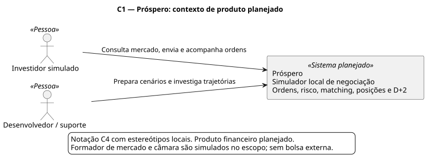
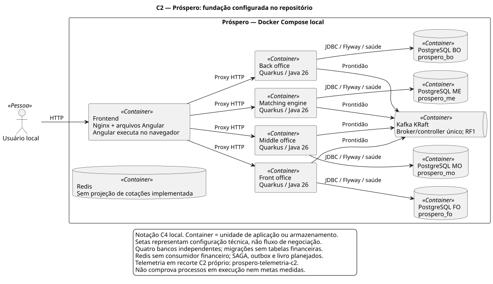
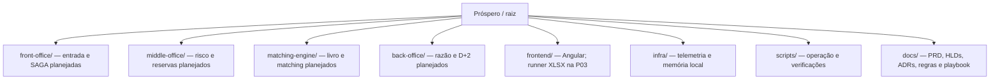

# Próspero

Simulador local de mercado financeiro com cinco ações fictícias, livro de ofertas, risco, execução, posições e liquidação simulada em D+2. Projeto de estudo, sem serviços pagos ou integração com bolsas reais.

## Estado atual

A fundação contém quatro microsserviços Quarkus/Java 26, Angular e Docker Compose. Cada serviço expõe identidade técnica, saúde, OpenAPI e métricas. O painel inicial consulta identidade e prontidão reais. **Negociação, risco e liquidação ainda não foram implementados.** Estado e PRs de entrega estão no [roadmap](docs/roadmap.md).

## Arquitetura e estrutura

O C1 mostra o **produto planejado**. Formador de mercado e liquidação são simulados; não há conexão com bolsa ou câmara reais.



O C2 mostra a **fundação configurada**: o frontend consulta as quatro APIs técnicas, cada serviço possui PostgreSQL próprio e Kafka é verificado para prontidão. Redis ainda não serve cotações; as setas não representam negociação implementada.



O [catálogo C4](docs/c4/README.md) inclui fontes editáveis, limites, o [C2 de telemetria](docs/c4/prospero-telemetria-c2.svg) e o C3 da identidade técnica. O [HLD do ecossistema](docs/hlds/HLD-001-arquitetura-prospero.md) mostra o fluxo financeiro de destino: FO coordena a SAGA, MO valida/reserva, ME executa e BO contabiliza/liquida, por eventos Kafka.

O mapa abaixo localiza as principais partes do repositório; as linhas indicam organização de pastas, sem dependência de código entre serviços.



As [decisões frente à proposta original](docs/adrs/README.md) explicam as substituições aceitas; PRD/HLDs preservam os requisitos e o desenho vigentes.

## Subir o ambiente

Pré-requisitos: Docker Engine com Compose v2 e Python 3. A máquina deve comportar os containers e a compilação; builds sequenciais reduzem o pico de memória. JDK e Node são instalados nas imagens, sem precisar alterar o Java do host.

```bash
python3 scripts/preparar-ambiente.py
docker compose config --quiet
COMPOSE_PARALLEL_LIMIT=1 docker compose build
docker compose up -d --wait --wait-timeout 240
python3 scripts/verificar-ambiente.py
```

O primeiro comando cria `.env` com credenciais aleatórias sem sobrescrever arquivo existente. As portas são exclusivas deste projeto e ficam publicadas somente em `127.0.0.1`. Nenhum banco, Kafka ou Redis é exposto ao host. Os nomes técnicos usam `prospero`, sem acento.

| Componente | Endereço local |
| --- | --- |
| Angular | http://localhost:4200 |
| Front office | http://localhost:8081/q/swagger-ui/ |
| Middle office | http://localhost:8082/q/swagger-ui/ |
| Matching engine | http://localhost:8083/q/swagger-ui/ |
| Back office | http://localhost:8084/q/swagger-ui/ |
| Grafana | http://localhost:13000 |
| Prometheus | http://localhost:19090 |
| Jaeger | http://localhost:16687 |
| Loki — prontidão | http://localhost:13100/ready |
| OpenTelemetry Collector — saúde | http://localhost:14333 |

Grafana: usuário `admin`, senha em `GRAFANA_ADMIN_PASSWORD` no `.env` local. Há um dashboard provisionado de fundação e fontes Prometheus/Loki/Jaeger. Os quatro dashboards financeiros serão entregues na V01. Jaeger usa memória nesta etapa; seus traces se perdem ao reiniciar. Demais dados de infraestrutura usam volumes nomeados do projeto.

## Desenvolvimento e testes

Com **JDK 26**, cada microsserviço funciona sem depender do POM da raiz:

```bash
cd front-office
./mvnw verify
```

Na raiz, `./mvnw verify` agrega os quatro builds. Com RAM limitada e outros projetos ativos, prefira executar cada serviço separadamente: o reator pode acumular memória entre módulos. Os testes de contrato usam HTTP com banco/Kafka desativados apenas no perfil de testes; a verificação Compose testa as dependências reais. Se o host tiver outra versão de Java, execute pelo container:

```bash
docker run --rm --memory=1g --cpus=2 \
  --user "$(id -u):$(id -g)" \
  -e MAVEN_USER_HOME=/tmp/maven \
  -e MAVEN_OPTS="-Xmx384m -XX:ActiveProcessorCount=2 -Duser.home=/tmp/prospero" \
  -v "$PWD:/workspace" -w /workspace/front-office \
  eclipse-temurin:26.0.2.1_1-jdk-noble sh ./mvnw -B -ntp verify
```

Repita o comando com o diretório de cada microsserviço. O exemplo mantém o cache Maven temporário dentro do container; um cache privado montado pode evitar novos downloads.

Angular requer Node 24.16.0 ou outra versão compatível com Angular 22.2.3:

```bash
cd frontend
npm ci
npm test -- --watch=false
npm run format:check
npm run build
npm start
```

`npm start` usa proxy para as APIs locais nas portas 8081–8084. A validação estática complementar roda com `python3 scripts/verificar-estrutura.py` na raiz. O runner de planilhas permanece na P03. O ai-memory já está instalado; veja [configuração e ativação dos hooks](docs/rules.md#memória-e-retomada).

## Operação local

```bash
docker compose ps
docker compose logs --tail=80 front-office
docker compose stop
docker compose start
```

`stop` preserva containers e dados. `docker compose down` remove containers/redes, preservando volumes nomeados. Não use `down -v` para uma parada normal: apaga os dados locais. Para subir só um microsserviço com seu banco e Kafka, use `docker compose up -d --build front-office`.

## Documentação e roadmaps

- [Índice da documentação](docs/README.md): requisitos, arquitetura e guias do projeto.
- [Regras canônicas](docs/rules.md), [ADRs](docs/adrs/README.md), [inventário](docs/libs.md) e [catálogo de skills](docs/skills/README.md).
- [Perfis de agentes](docs/agentes/README.md), incluindo o gerador C4.
- [Roadmap global](docs/roadmap.md): uma tarefa principal por requisito funcional.
- Roadmaps: [FO](front-office/ROADMAP.md), [MO](middle-office/ROADMAP.md), [matching](matching-engine/ROADMAP.md), [BO](back-office/ROADMAP.md) e [Angular](frontend/ROADMAP.md).
- [HLD do ecossistema e dos microsserviços](docs/hlds/README.md).

Cada tarefa exige PR com alterações, motivos, trade-offs e validação. Repositório: [mclovin137/Prospero](https://github.com/mclovin137/Prospero). Veja [CI e runner dedicado](docs/rules.md#ci-e-runner); resumos locais não equivalem a PR aberto.
