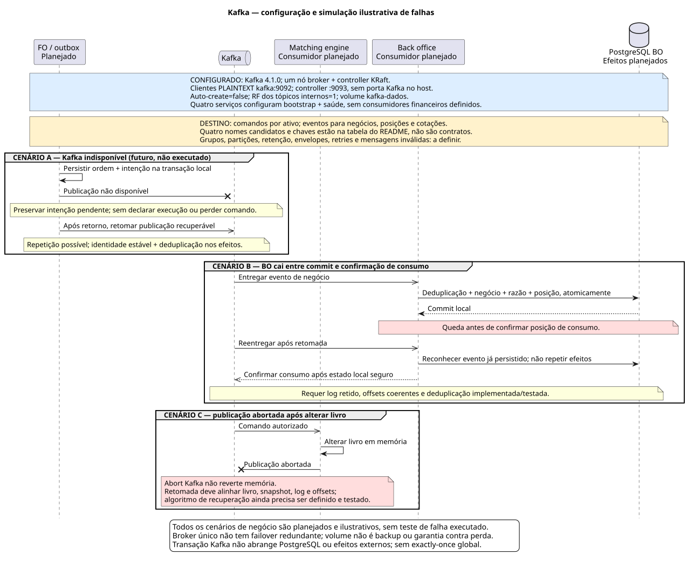
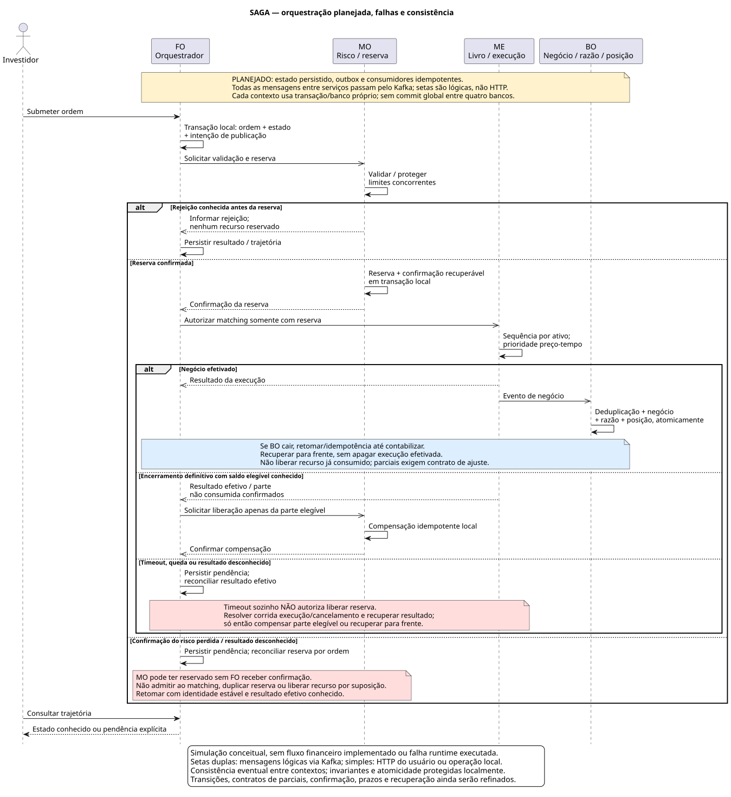
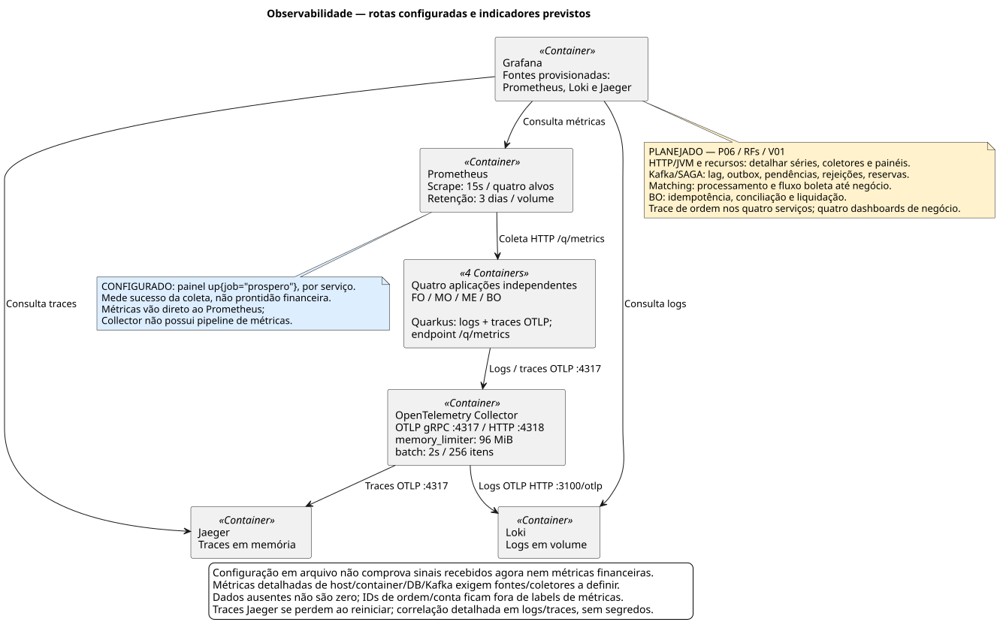

# Próspero

Simulador local de mercado financeiro com cinco ações fictícias, livro de ofertas, risco, execução, posições e liquidação simulada em D+2. Projeto de estudo, sem serviços pagos ou integração com bolsas reais.

## Estado atual

A fundação contém quatro microsserviços Quarkus/Java 26, Angular e Docker Compose. Cada serviço expõe identidade técnica, saúde, OpenAPI e métricas. O painel inicial consulta identidade e prontidão reais. **Negociação, risco e liquidação ainda não foram implementados.** Estado e PRs de entrega estão no [roadmap](docs/roadmap.md).

## Arquitetura dos microsserviços e bancos

Cada microsserviço tem build, credenciais, migrações e PostgreSQL próprios. As linhas do desenho representam a **fundação configurada**: proxy técnico do frontend, acesso ao próprio banco e saúde do Kafka. O livro de ofertas e as tabelas financeiras ainda não existem.


No desenho de negócio **planejado**, FO recebe ordens e orquestra a SAGA; MO valida e reserva recursos; ME executa por prioridade preço-tempo; BO registra negócios, razão, posições e D+2. A colaboração ocorre por Kafka, sem HTTP ou acesso a banco entre microsserviços. O livro do ME ficará em memória, com log e snapshots; seu PostgreSQL será de suporte, sem consulta por ordem.

## Kafka, tópicos, consumidores e falhas

**Configuração atual:** Kafka 4.1.0, um nó KRaft com papéis broker/controller. Clientes usam `kafka:9092` e o controller usa `9093`, ambos PLAINTEXT na rede local; Kafka não publica porta no host. A criação automática de tópicos está desativada. Os fatores de replicação dos tópicos internos e o mínimo de réplicas da transação estão em 1; dados ficam no volume `kafka-dados`. Nó único e volume não fornecem failover ou backup.

Os quatro serviços configuram bootstrap e verificação de saúde. **Não há provisionamento de tópicos nem grupos/produtores/consumidores financeiros no código.** Estes nomes vêm do catálogo histórico do HLD e são candidatos, não contratos aprovados:

| Tópico candidato | Chave sugerida | Objetivo de destino |
| --- | --- | --- |
| `ordens.comandos` | Ativo | Sequenciar comandos autorizados para matching. |
| `mercado.negocios` | Ativo | Distribuir execuções para registro e outros efeitos de negócio. |
| `posicoes.eventos` | Conta | Distribuir mudanças de posição; passagem de ordem por ativo para conta a definir. |
| `mercado.precos` | A definir | Alimentar projeções de cotações; assinantes e chave ainda a definir. |

A organização pretendida separa responsabilidades: FO recebe resultados e acompanha a SAGA; MO trata validação/reserva e liberação; ME processa comandos com um escritor por ativo; BO registra execuções e calcula posições. IDs de grupos, partições, assinaturas, schemas, retenção, commits de offsets, concorrência, retries e tratamento de mensagens inválidas serão definidos antes da implementação. O grupo deve preservar um proprietário por partição/livro; não há ordem global entre tópicos.



A figura **simula conceitualmente** três falhas, sem executar interrupções: publicação indisponível mantém intenção recuperável; queda do BO após commit exige reentrega sem repetir efeitos; publicação abortada no ME exige alinhar memória, log, snapshot e offsets. A retomada depende de dados retidos e mecanismos ainda a implementar/testar. Transação Kafka não reverte o livro em memória nem abrange PostgreSQL. Fontes: [Compose](docker-compose.yml), [configuração dos serviços](front-office/src/main/resources/application.properties), [HLD](docs/hlds/HLD-001-arquitetura-prospero.md) e [limites de entrega do Kafka](https://kafka.apache.org/41/design/design/).

## SAGA e consistência em caso de erro

A SAGA será **orquestrada pelo FO**, com estado e próximos passos persistidos. O desenho usa transações locais, outbox para publicação recuperável e deduplicação atômica com os efeitos. Essas responsabilidades estão decididas no ADR-002; os componentes, estados e contratos ainda não estão implementados. As setas entre serviços abaixo representam mensagens lógicas via Kafka.



A consistência pretendida depende destas invariantes e dos testes de falha correspondentes:

- Matching só admite ordem com reserva confirmada; concorrência não pode reservar o mesmo recurso duas vezes.
- Rejeição conhecida antes da reserva encerra sem liberar algo que não foi reservado. Encerramento definitivo permite compensar apenas a parte elegível, de forma idempotente.
- Timeout ou queda com resultado desconhecido mantém pendência e exige reconciliação; **não libera reserva automaticamente**.
- Negócio já efetivado se recupera para frente até contabilizar; não é apagado para compensar uma falha posterior. Parciais e corridas de cancelamento exigem contratos próprios.
- Reentrega não duplica reserva, negócio, lançamento ou posição. Atomicidade é local e consistência entre contextos é eventual, sem commit global nem exactly-once geral.

Isso descreve como a consistência deverá ser construída e verificada, não uma garantia já comprovada. Fontes: [ADR-002](docs/adrs/ADR-002-padroes-dominio.md) e [HLDs dos serviços](docs/hlds/README.md).

## Observabilidade e indicadores

Os serviços enviam logs/traces por OTLP ao Collector; ele encaminha traces ao Jaeger e logs ao Loki. Prometheus coleta **diretamente** `/q/metrics` das quatro aplicações a cada 15 segundos; o Collector não possui pipeline de métricas. Grafana consulta as três fontes. A retenção Prometheus é de três dias; Jaeger usa memória e perde traces no reinício.



| Área | Indicadores a acompanhar | Estado |
| --- | --- | --- |
| Coleta técnica | `up{job="prospero"}` por serviço | Consulta do dashboard atual; sucesso de scrape não comprova prontidão financeira. |
| HTTP/JVM e recursos | Vazão, erros, latência, heap/GC, CPU, memória, disco/rede e pools | Endpoint técnico configurado; inventariar séries, coletores necessários e painéis na P06. |
| Kafka e publicação | Lag, idade do backlog/outbox, falhas e reentregas | Planejado; depende dos consumidores/publicadores e fontes de métricas. |
| SAGA e risco | Ordens pendentes/rejeitadas, tempo por etapa, reservas e compensações | Planejado nas RFs; controlar duplicação e recursos sem resolução. |
| Matching | Tempo de processamento e boleta até negócio; sequência/replay | Planejado; RNF04 exige p99 boleta→negócio < 50 ms e matching < 1 ms/ordem em cenário documentado. |
| Back office | Duplicações evitadas, conciliação de caixa/custódia, razão e liquidações pendentes | Planejado; medir invariantes e recuperação nas RF07/RF08. |
| Mercado e trajetória | Idade/ausência da cotação e trace da ordem nos quatro serviços | Planejado; quatro dashboards de negócio e alertas na V01. |

Ausência de série aparece como ausente, não zero. IDs de conta/ordem/execução ficam na correlação sanitizada de logs/traces, sem labels de alta cardinalidade nem segredos. Metas futuras exigem medições; configuração não comprova desempenho. Fontes: [Collector](infra/otel/collector.yaml), [Prometheus](infra/prometheus/prometheus.yml), [dashboard atual](infra/grafana/dashboards/fundacao.json) e [roadmap](docs/roadmap.md). Fontes editáveis e critérios das figuras: [catálogo de diagramas](docs/c4/README.md).

## Subir o ambiente

Pré-requisitos: Docker Engine com Compose v2 e Python 3. A máquina deve comportar os containers e a compilação; builds sequenciais reduzem o pico de memória. JDK e Node são instalados nas imagens, sem precisar alterar o Java do host.

```bash
python3 scripts/preparar-ambiente.py
docker compose config --quiet
COMPOSE_PARALLEL_LIMIT=1 docker compose build
docker compose up -d --wait --wait-timeout 240
python3 scripts/verificar-ambiente.py
```

O primeiro comando cria `.env` com credenciais aleatórias sem sobrescrever arquivo existente. As portas são exclusivas deste projeto e ficam publicadas somente em `127.0.0.1`. Nenhum banco, Kafka ou Redis é exposto ao host. Os nomes técnicos usam `prospero`, sem acento.

| Componente | Endereço local |
| --- | --- |
| Angular | http://localhost:4200 |
| Front office | http://localhost:8081/q/swagger-ui/ |
| Middle office | http://localhost:8082/q/swagger-ui/ |
| Matching engine | http://localhost:8083/q/swagger-ui/ |
| Back office | http://localhost:8084/q/swagger-ui/ |
| Grafana | http://localhost:13000 |
| Prometheus | http://localhost:19090 |
| Jaeger | http://localhost:16687 |
| Loki — prontidão | http://localhost:13100/ready |
| OpenTelemetry Collector — saúde | http://localhost:14333 |

Grafana: usuário `admin`, senha em `GRAFANA_ADMIN_PASSWORD` no `.env` local. Há um dashboard provisionado de fundação e fontes Prometheus/Loki/Jaeger. Os quatro dashboards financeiros serão entregues na V01. Jaeger usa memória nesta etapa; seus traces se perdem ao reiniciar. Demais dados de infraestrutura usam volumes nomeados do projeto.

## Desenvolvimento e testes

Com **JDK 26**, cada microsserviço funciona sem depender do POM da raiz:

```bash
cd front-office
./mvnw verify
```

Na raiz, `./mvnw verify` agrega os quatro builds. Com RAM limitada e outros projetos ativos, prefira executar cada serviço separadamente: o reator pode acumular memória entre módulos. Os testes de contrato usam HTTP com banco/Kafka desativados apenas no perfil de testes; a verificação Compose testa as dependências reais. Se o host tiver outra versão de Java, execute pelo container:

```bash
docker run --rm --memory=1g --cpus=2 \
  --user "$(id -u):$(id -g)" \
  -e MAVEN_USER_HOME=/tmp/maven \
  -e MAVEN_OPTS="-Xmx384m -XX:ActiveProcessorCount=2 -Duser.home=/tmp/prospero" \
  -v "$PWD:/workspace" -w /workspace/front-office \
  eclipse-temurin:26.0.2.1_1-jdk-noble sh ./mvnw -B -ntp verify
```

Repita o comando com o diretório de cada microsserviço. O exemplo mantém o cache Maven temporário dentro do container; um cache privado montado pode evitar novos downloads.

Angular requer Node 24.16.0 ou outra versão compatível com Angular 22.2.3:

```bash
cd frontend
npm ci
npm test -- --watch=false
npm run format:check
npm run build
npm start
```

`npm start` usa proxy para as APIs locais nas portas 8081–8084. A validação estática complementar roda com `python3 scripts/verificar-estrutura.py` na raiz. O runner de planilhas permanece na P03. O ai-memory já está instalado; veja [configuração e ativação dos hooks](docs/rules.md#memória-e-retomada).

## Operação local

```bash
docker compose ps
docker compose logs --tail=80 front-office
docker compose stop
docker compose start
```

`stop` preserva containers e dados. `docker compose down` remove containers/redes, preservando volumes nomeados. Não use `down -v` para uma parada normal: apaga os dados locais. Para subir só um microsserviço com seu banco e Kafka, use `docker compose up -d --build front-office`.

## Documentação e roadmaps

- [Índice da documentação](docs/README.md): requisitos, arquitetura e guias do projeto.
- [Regras canônicas](docs/rules.md), [ADRs](docs/adrs/README.md), [inventário](docs/libs.md) e [catálogo de skills](docs/skills/README.md).
- [Perfis de agentes](docs/agentes/README.md), incluindo o gerador C4.
- [Roadmap global](docs/roadmap.md): uma tarefa principal por requisito funcional.
- Roadmaps: [FO](front-office/ROADMAP.md), [MO](middle-office/ROADMAP.md), [matching](matching-engine/ROADMAP.md), [BO](back-office/ROADMAP.md) e [Angular](frontend/ROADMAP.md).
- [HLD do ecossistema e dos microsserviços](docs/hlds/README.md).

Cada tarefa exige PR com alterações, motivos, trade-offs e validação. Repositório: [mclovin137/Prospero](https://github.com/mclovin137/Prospero). Veja [CI e runner dedicado](docs/rules.md#ci-e-runner); resumos locais não equivalem a PR aberto.
