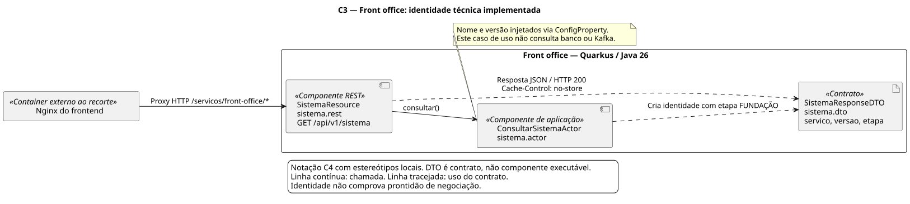

# Diagramas C4 do Próspero

Notação C4 por estereótipos locais em PlantUML autocontido; não depende da biblioteca C4-PlantUML nem de includes remotos. Os desenhos aplicam o [perfil do projeto](../agentes/c4-diagram-generator.md), a proposta em leitura do agente C4 e a distinção entre planejado e implementado. Nenhum diagrama aprova arquitetura nova.

| Nível / recorte | Imagem | Fonte editável | Estado representado |
| --- | --- | --- | --- |
| C1 — Contexto | [SVG](prospero-c1.svg) | [PlantUML](prospero-c1.puml) | Produto planejado; pessoas e fronteira do simulador. |
| C2 — Containers | [SVG](prospero-c2.svg) | [PlantUML](prospero-c2.puml) | Fundação configurada no Compose; sem fluxo financeiro. |
| C2 — Telemetria | [SVG](prospero-telemetria-c2.svg) | [PlantUML](prospero-telemetria-c2.puml) | Recorte dos mesmos containers e dos cinco componentes de observabilidade. |
| C3 — Identidade do FO | [SVG](front-office-identidade-c3.svg) | [PlantUML](front-office-identidade-c3.puml) | Componentes reais de consulta técnica; DTO é contrato. |



## Fontes e limites

C1: recorte dos atores investidor e desenvolvedor/suporte; analista de risco e operador de back office foram omitidos para manter a visão de entrada compacta, sem excluir esses papéis do produto. Fontes de atores e escopo: [PRD-001](../prds/PRD-001-simulador-prospero.md). Formador de mercado e câmara são simulados dentro do escopo; papéis de risco/back office não implicam UI ou autorização existente.

C2 de fundação e recorte de telemetria: [Compose](../../docker-compose.yml), [Nginx](../../frontend/nginx.conf), [configuração FO](../../front-office/src/main/resources/application.properties), equivalentes dos outros serviços, [Collector](../../infra/otel/collector.yaml), [Prometheus](../../infra/prometheus/prometheus.yml) e [datasources Grafana](../../infra/grafana/provisioning/datasources/fontes.yaml). Redis está configurado, sem consumidor de cotações. Conexões a banco/Kafka são infraestrutura técnica; não comprovam tabelas financeiras, produtores/consumidores de negócio ou processos atualmente em execução. Serviços têm bancos independentes; não são réplicas. A porta 4200 serve Nginx/arquivos; Angular executa no navegador. O C2 omite portas, volumes, redes e memória auxiliar para legibilidade; esses detalhes permanecem no Compose e em [memória](../rules.md#memória-e-retomada).

C3: [Resource](../../front-office/src/main/java/br/prospero/fo/sistema/rest/SistemaResource.java), [Actor](../../front-office/src/main/java/br/prospero/fo/sistema/actor/ConsultarSistemaActor.java) e [DTO](../../front-office/src/main/java/br/prospero/fo/sistema/dto/SistemaResponseDTO.java). Não desenhar domínio, Helper ou repositório financeiro a partir de pacotes vazios.

Decisões: [ADR-001](../adrs/ADR-001-arquitetura-backend.md) e [ADR-002](../adrs/ADR-002-padroes-dominio.md). Destino financeiro: [HLD-001](../hlds/HLD-001-arquitetura-prospero.md) e HLDs de contexto. O [índice de ADRs](../adrs/README.md) distingue herança e substituições da proposta original.

Não criar C3 financeiro enquanto não houver componentes reais. C4 de código omitido: repetir três classes técnicas não acrescentaria informação ao C3. MER/DER são modelos de dados, não níveis C4; o dicionário preliminar pertence aos HLDs dos proprietários e precisa de refinamento antes de virar schema.

## Atualização e renderização

Editar `.puml`, conferir contra fontes atuais e regenerar `.svg` na mesma alteração. A renderização desta entrega usou PlantUML **1.2025.2**, JAR temporário fora do projeto e layout Java Smetana, sem Graphviz, includes remotos ou envio dos diagramas a servidores externos:

```bash
java -jar /caminho/local/plantuml-1.2025.2.jar -tsvg -charset UTF-8 docs/c4/*.puml
```

PlantUML é ferramenta opcional de documentação, sem dependência de runtime/build do produto. As imagens versionadas permitem leitura no GitHub sem instalar renderizador. O mapa Mermaid no README é organizacional, não um nível C4 nem grafo de dependências Maven.
