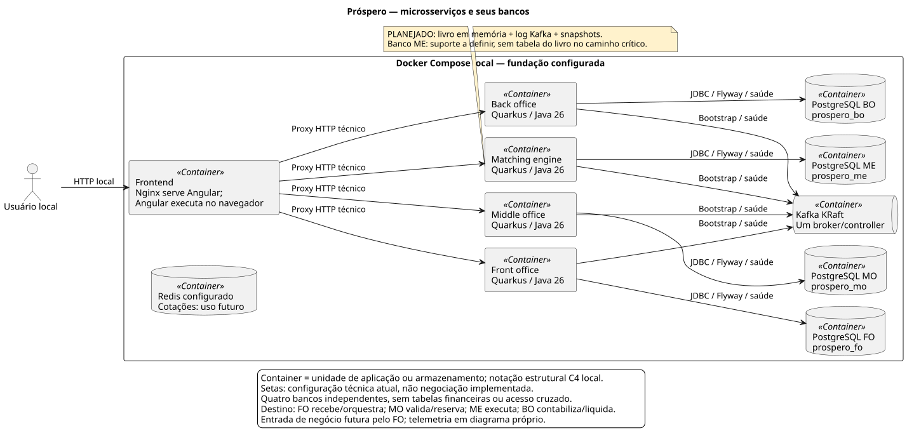

# HLD-001 — Ecossistema Próspero

Data: 2026-10-17. Desenho baseado no [PRD-001](../prds/PRD-001-simulador-prospero.md), ADRs aceitos e manifests/código existentes. A extração não introduz decisões nem torna o destino arquitetural implementado. [Roadmap](../roadmap.md) registra o andamento.

## Objetivo técnico e estado atual

Separar quatro contextos financeiros, demonstrar comunicação assíncrona e permitir operação/testes/observabilidade locais com custo financeiro zero. A fundação contém quatro projetos Quarkus/Java26 e quatro PostgreSQL, Angular, Kafka, Redis e telemetria. RF01–RF04 implementam mercado, ordens/validação e SAGA de risco/reserva FO ↔ MO; RF05 integra MO → ME → MO/FO, Stop/Stop Limit, OCO, encerramento e robô. RF06 integrada projeta cotação real/VWAP e atualiza a tela. RF07 integrada acrescenta projeção idempotente de posições/PnL no BO e consulta Angular. RF08 integrada acrescenta razão/liquidação/histórico e créditos D+2; RF09 em implementação acrescenta trajetória e WebSocket; cancelamento RF10 permanece planejado. O roadmap registra PRs/evidências.

A P05 adicionou a conversão decimal técnica pura no MO, integrada pelo PR #3. Validação financeira, risco e reservas vieram depois, nas RF03–RF04 (ADR-011 e ADR-012).

## Arquitetura

O [catálogo de diagramas](../c4/README.md) reúne serviços/bancos, Kafka/recuperação, SAGA/consistência e observabilidade. As figuras e o [README](../../README.md) distinguem configuração técnica, destino financeiro e cenários ilustrativos, sem ensaio runtime nesta revisão. O [índice de ADRs](../adrs/README.md) registra as substituições frente à proposta original.

A figura estrutural representa a fundação: Nginx encaminha consultas técnicas aos quatro serviços. Negociação futura usará FO como entrada, sem Angular orquestrar SAGA. [Kafka](../c4/kafka-recuperacao.svg) e [SAGA](../c4/saga-consistencia.svg) mostram recuperação planejada, ainda não implementada/testada financeiramente; [observabilidade](../c4/observabilidade.svg) separa sinais técnicos atuais de indicadores futuros.

| Componente | Responsabilidade |
| --- | --- |
| Front office | Receber ordens, persistir sua trajetória, orquestrar SAGA e expor dados ao investidor. |
| Middle office | Validar ordens e limites e reservar/liberar recursos atomicamente. |
| Matching engine | Executar ordens em sequência por ativo, com prioridade preço-tempo e replay determinístico. |
| Back office | Registrar negócios e razão, calcular posições e resultados e simular D+2. |
| Angular | Apresentar operações e estados; hospedar o módulo CLI de testes por planilha. |

Cada microsserviço possui build, imagem, migrações, credenciais e container PostgreSQL próprios. Os demais não acessam seu banco nem sua implementação. A colaboração de negócio ocorre via Kafka; a disponibilidade de todos não é exigida para iniciar cada processo, mas o fluxo ponta a ponta depende de seus participantes.

REST chama Actor; Actor coordena domínio/Helpers puros e repositórios JPA separados. O domínio não conhece HTTP, Quarkus ou JPA. SAGA, outbox e consumidores idempotentes coordenam o fluxo FO ↔ MO; os demais saltos são futuros. O livro permanece em memória, sem consultar banco por ordem. DDD e Object Calisthenics seguem os [ADRs](../adrs/README.md).

## Fluxos e contratos

Atual: navegador → Nginx/proxy Angular → identidade técnica, mercado e ordens no FO e carteiras de risco no MO. As ordens registradas/validadas seguem por outbox/Kafka para reserva ou rejeição no MO, retornando ao FO. Cada aplicação verifica suas dependências locais de saúde; testes de contrato e integração distinguem infraestrutura desativada de dependências reais.

Planejado: investidor → API FO → registro e SAGA/outbox → Kafka → validação/reserva MO → matching sequencial ME → execução/contabilidade BO → projeções e estados consultáveis no FO/Angular. Representa responsabilidades de destino; nomes de tópicos, esquemas, transições, compensações e garantias de publicação serão definidos nas RFs e não constituem contratos já existentes.

Contratos HTTP de negócio: DTOs, `/api/v1`, Swagger/OpenAPI e status adequados conforme [ADR-003](../adrs/ADR-003-contratos-api.md). `202` não confirma negociação e `204` não contém JSON. Endpoints técnicos Quarkus mantêm caminhos próprios. Frontend não coordena transação financeira nem consulta bancos.

## Dados e consistência

Cada serviço é fonte de verdade de seu contexto e dono de credenciais/migrações Flyway. FO/MO possuem ordens, reservas, outbox e deduplicação; ME acrescenta metadados de replay na RF05b, sem tabela do livro; BO acrescenta na RF07 o log/checkpoint e projeções de posição/cotação no banco próprio; razão/liquidação continuam RF08. Não existe commit global. Reservas, consumo/liberação e progresso usam transações locais e reentrega idempotente. Timeout sozinho não autoriza liberar recurso quando execução ainda pode ocorrer.

Livro em memória, replay da sessão e checkpoint PostgreSQL seguem ADR-013; RF05b opera laboratório de sessão única/posse exclusiva e retenção integral, sem snapshots/rebalanceamento automático. A projeção de mercado pertence ao PostgreSQL do FO (ADR-009/RF06a); Redis é somente candidato a cache medido, sem autoridade para reserva. Quatro bancos independentes não são réplicas. Kafka atual possui broker único KRaft/RF1; consenso/replicação distribuída entre bancos são N/A. Versões reais e adoção ficam em [libs](../libs.md).

## Segurança

Ambiente de estudo, sem dados/operações financeiras reais. Portas publicadas em loopback, configuração sensível local fora do Git e permissões/bancos separados. Não tratar loopback como proteção suficiente: FO e MO validam JWT local e escopo de conta; proxy injeta tokens locais sem expô-los ao navegador (ADR-009/ADR-012). Isso não implementa cadastro/senhas nem os papéis conceituais completos do PRD. Preservar DTOs, limites de entradas e logs sem credenciais. A ferramenta técnica de carga usa alvos enumerados e limites contra abuso/SSRF, com JWT HS256 de controle e atestado externo de preflight assinados por chaves distintas; não expõe comandos/socket Docker.

### Eventos autenticados e senhas — avaliação de mecanismos

**Parecer: válido com ressalvas, mecanismos candidatos.** Kafka atual usa PLAINTEXT em broker único; não há TLS/ACL de negócio, HMAC ou cadastro/senhas de usuários implementados. “Middle para back” não altera a sequência lógica MO → ME → BO: MO fornece risco, ME produz execuções, BO contabiliza. Proteger contratos dos produtores legítimos, sem criar atalho HTTP ou permitir que MO invente execução.

| Mecanismo | Proteção e limite |
| --- | --- |
| HMAC em envelope de evento | Autenticidade/integridade do conteúdo com segredo compartilhado; não cifra, não comprova correção financeira nem não repúdio, e o verificador com a chave também consegue produzir MAC |
| TLS mútuo no Kafka + ACLs | Confidencialidade/integridade do canal e identidade cliente–broker com permissão mínima de tópico/grupo; broker termina conexões e armazena o registro, portanto não equivale a autenticação criptográfica do registro de ponta a ponta |
| Argon2id para senha local futura | Hash adaptativo de senha com salt exclusivo; só se identidade local for adotada. Não é substituto de HMAC/TLS nem tratamento automático de senhas de banco/chaves |

HMAC e mTLS resolvem ameaças distintas e podem ser complementares. Antes da adoção material, registrar ADR com ameaça, alternativa, algoritmo/versão, chaves/certificados e operação no orçamento local. Fontes: [HMAC/RFC2104](https://www.rfc-editor.org/rfc/rfc2104), [segurança Kafka](https://kafka.apache.org/41/security/security-overview/).

Para HMAC, definir bytes autenticados preservados ou serialização canônica, envelope limitado com ID/schema/origem/destino/contexto/correlação/keyId autenticados, algoritmo permitido fixado pela política e verificação em tempo constante. Outbox preserva ocorrência/proveniência; reentrega e rotação não criam novo efeito. Distribuir/rotacionar/revogar chaves fora do Git/imagem/log; manter verificabilidade necessária ao replay. MAC válido não impede replay: deduplicar atomicamente com os efeitos. Não rejeitar backlog legítimo por janela temporal arbitrária; política de recuperação precisa ser explícita. Evento inválido não produz efeito financeiro; destino operacional e diagnóstico limitado serão definidos no contrato.

Para TLS, avaliar autenticação de cliente obrigatória (`ssl.client.auth=required`), validação de hostname/SAN e CA, certificados por identidade, renovação e ACLs mínimas de publicação/consumo. `requested` não obriga certificado. Não desabilitar validação para facilitar ambiente local e não chamar canais TLS ao broker de assinatura do conteúdo persistido. [TLS Kafka4.1](https://kafka.apache.org/41/security/encryption-and-authentication-using-ssl/), [ACLs](https://kafka.apache.org/41/security/authorization-and-acls/).

Para Argon2id, somente após decidir autenticação local: biblioteca mantida/versionada, salt aleatório por senha, parâmetros/versão junto do hash, verificação e atualização de custo. Medir memória/tempo no container real e limitar tentativas/concorrência. Perfis da RFC variam muito; não copiar valores incompatíveis com 384 MiB/1 CPU. A referência mínima OWASP consultada é 19 MiB, duas iterações e paralelismo1, ponto de avaliação sem adoção automática. Nenhuma senha/hash vai para log; não usar criptografia reversível para armazenar senha. [RFC9106](https://www.rfc-editor.org/rfc/rfc9106), [OWASP](https://cheatsheetseries.owasp.org/cheatsheets/Password_Storage_Cheat_Sheet.html).

Critérios futuros: adulteração de payload/envelope/origem/schema/keyId, chave errada/rotação/replay; certificado ausente/expirado/CA ou hostname incorretos e ACL negada; senhas iguais com salts distintos, senha incorreta, atualização de custo e saturação limitada. São testes propostos, sem execução ou configuração criptográfica nesta entrega.

## Observabilidade e desempenho

Diferentemente da centralização dos três sinais no Collector proposta no PDF (§14), a configuração vigente usa coleta direta de métricas pelo Prometheus. Prometheus coleta métricas das quatro aplicações; OTel envia traces/logs para Jaeger/Loki; Grafana integra fontes. O painel de fundação é técnico; a fatia V01a acrescenta quatro painéis operacionais dos fluxos já implementados, ainda sujeitos à validação registrada no roadmap. Traces Jaeger usam memória e não persistem após reinício; demais componentes persistentes usam volumes conforme Compose. Métricas de host/container/DB/Kafka detalhadas ainda exigem coletores e não podem aparecer como zero por ausência de fonte.

A [P06](../roadmap.md), etapa A em implementação/revisão, acrescenta ferramenta técnica em **Go 1.27.3**, com `net/http` e executor nativo ([ADR-006](../adrs/ADR-006-api-carga.md)). O [HLD-006](HLD-006-api-carga.md) define contratos/limites; o [OpenAPI](../../ferramentas/carga/openapi.json) registra as rotas. O container `api-carga` é opt-in no overlay `docker-compose.carga.yml`, com controle loopback `8090`, métricas internas `9091`, redes web/telemetria, 384 MiB/1 CPU, usuário 65532 e filesystem somente leitura. Não é quinto contexto financeiro e não recebe banco/Kafka/Redis/socket Docker. O perfil não inicia por padrão nem gera carga na CI.

A execução única oferece somente `GET /api/v1/sistema` dos quatro MS. No modo aberto, usa calendário de oferta; no fechado, RPS limita oportunidades globais e VUs limita ocupação, reduzindo vazão enquanto VUs estão bloqueados. Não equivale a usuários autenticados. O relatório distingue oferta prevista/percorrida, contagens, quantis e durações planejadas/observadas por fase, sem sobreposição entre aquecimento e medição. Cancelamento interrompe oferta e chamadas em voo antes do estado terminal; reinício perde histórico volátil e não repete tráfego.

O operador prepara chaves externas distintas e usa `scripts/carga.py` para emitir preflight de até 30 s vinculado a instância/plano/nonce. O host verifica RAM/CPU/disco e saúde de Prometheus/Grafana/Collector por endpoints próprios de leitura, incluindo `telemetria:true` no atestado; não reserva recursos. O atestado entra em `X-Prospero-Preflight` ou no campo `autorizacao`, nunca ambos (`400`). Arquivos privados ficam em `.carga-local/` com diretório `0700`; chaves `0444` para binds individuais legíveis pelo UID 65532, sem montar o diretório inteiro.

Prometheus coleta a ferramenta a cada 2 s; o [painel técnico](../../infra/grafana/dashboards/carga.json) apresenta métricas reais Go/JVM. CPU/RSS/heap/GC do processo Go incluem API e gerador. Host/cgroups, disco/rede, DB/Kafka/outbox e projeções detalhados continuam sem fontes completas; ausência não é zero. Esses painéis complementam os quatro operacionais da V01a, em validação. Sem carga financeira medida ou RNF04 comprovado; metas do PRD exigem hardware, carga, janela e amostras documentados. Labels têm cardinalidade limitada e não incluem IDs de execução/usuário; logs não recebem credenciais ou payloads.

### Painéis e alertas operacionais — V01a

Grafana usa somente os plugins de fontes incluídos na imagem 13.2.4: Prometheus 13.2.3, Loki 13.2.2 e Jaeger 13.0.5. Preinstall/atualização automática e administração de plugins na UI ficam desabilitados; cópias baixadas no volume são preservadas e ignoradas pela seleção de caminho. O orçamento é 384 MiB, após OOM reproduzida com 256 MiB. Validação e limites no inventário/roadmap; não inferir capacidade de uma inicialização saudável.

Os quatro dashboards provisionados usam o datasource Prometheus existente e labels finitas de serviço, tipo, resultado, motivo ou tópico. Fontes: FO recebe/aplica ordens e mede boleta→primeiro negócio; MO decide risco e expõe pendências de crédito; ME conta comandos/eventos e mede processamento sem I/O; BO expõe prontidão/falhas/quarentena de posições e transporte por outbox. O painel de mercado agrega a projeção de cotação do FO ao processamento ME.

Os contadores são observações operacionais, podem incluir reentrega ou anteceder o commit; não são razão financeira de efeitos únicos. Decisão RESERVADA não mede estoque/valor reservado. Eventos ME não equivalem a negócios. O BO não possui contadores de lançamentos D0/D2 ou liquidações concluídas nesta fatia; pendências de crédito exibidas são do MO. Gauges MO e de outbox podem conservar o último valor após erro de atualização: scrape saudável não comprova frescor ou conciliação. Séries ausentes permanecem sem dados, sem conversão artificial em zero.

Histogramas usam janela de5min, agregação por `le` e contagem de amostras; o p99 é aproximação pelos buckets. FO inclui primeiro negócio da agressora e particularidades de Stop/rollback já descritas no HLD-004; ME mede núcleo e serialização, sem poll/publicação. Esses gráficos não substituem o ensaio RNF04 ou comprovam suas metas.

As regras locais em `infra/prometheus/alertas.yml` aparecem na UI do Prometheus, sem envio externo de notificações. Condições iniciais: scrape indisponível por 1 min, processamento sem prontidão por 2 min, série esperada ausente por 2 min, quarentena incrementada em 5 min ou contador positivo sem amostra correspondente no offset de 5 min, outbox com pendências por 2 min e crédito aguardando observado no MO com idade > 120 s por 2 min. Os p99 acima de 50 ms no FO ou 1 ms no ME exigem pelo menos 100 observações nos últimos 5 min e persistência de 2 min; são diagnósticos, não aceite da meta. Tempos de operação são escolhas iniciais desta fatia, calibráveis com evidência, sem alterar PRD.

O ramo de contador positivo cobre primeira exposição em 1 sem baseline 0; offset de 5 min usa lookback e não prova instante exato da ocorrência. Resolução de quarentena recente significa somente fim da janela observada, não recuperação financeira. O operador confere prontidão, APIs e logs antes de agir; nenhum alerta libera reserva ou compensa negócio. O aceite exige promtool para disparo/persistência/recuperação/ausência/reset/ociosidade; smoke e capturas em CI deverão conferir séries, consultas, carregamento de regras e provisionamento. Restaurar configurações anteriores e recriar somente Prometheus/Grafana preserva volumes; não apagar TSDB ou dados financeiros.

## Escalabilidade, resiliência e implantação

Inicialmente uma stack Compose local; nenhuma promessa de alta disponibilidade, cluster ou escala horizontal validada. ME terá escritor único por ativo e replay determinístico. Integração assíncrona exige tratar atraso e reentrega; não prometer exactly-once fim a fim ou conclusão sem participantes.

Builds independentes por serviço; JDK26 e versões fixadas no ADR-005. Comandos reais e portas no [README](../../README.md), operação na skill subir-sistema e CI no [guia](../rules.md#ci-e-runner). CI remota roda em runner hospedado gratuito do GitHub; checks locais não comprovam execução GitHub. Flyway evolui cada banco sem acesso a tabelas de outro serviço. Não executar limpeza destrutiva de volumes para iniciar/validar.

## Riscos, trade-offs e decisões

| Risco / trade-off | Tratamento |
| --- | --- |
| Quatro bancos e telemetria elevam RAM/CPU local | Preflight e limites; não concorrer com stress de outros projetos, preservar Horus. |
| Eventos geram atraso, duplicidade e contratos coordenados | Estados explícitos, testes de reentrega e implementação futura de outbox/deduplicação. |
| Regras financeiras ainda abertas | Definir escalas, calendários e concorrência antes das tarefas dependentes. |
| Observabilidade ou gerador saturados distorcem medições | Orçamento conjunto e métricas separadas; não comprovar capacidade com endpoint de identidade. |

Decisões: [ADR-001 backend/fronteiras](../adrs/ADR-001-arquitetura-backend.md), [ADR-002 padrões](../adrs/ADR-002-padroes-dominio.md), [ADR-003 HTTP](../adrs/ADR-003-contratos-api.md), [ADR-004 testes](../adrs/ADR-004-testes-planilha.md) e [ADR-005 versões](../adrs/ADR-005-versoes-fundacao.md). Aceita não significa implementada; evolução incompatível exige substituição explícita. Go, biblioteca padrão HTTP e executor nativo restrito foram adotados no [ADR-006](../adrs/ADR-006-api-carga.md); aceite/validações da P06 ficam no roadmap e no PR.

## Verificação e rastreabilidade

Fundação: P02 e suas [evidências — histórico Git](https://github.com/mclovin137/Prospero/blob/bd707fa972aa36c6811fa00d13ad73c3073721c1/docs/evidencias/P02-testes.md). Invariantes de precisão técnica: P05 integrada pelo PR #3. Produto financeiro: RF01–RF04 integradas, RF05 integrada até PR #36, RF06 integrada nos PRs #37/#38, RF07 em validação e RF08–RF10 planejadas; PRs, revisões e testes discriminados no roadmap. P03 implementada; validação final em V01. Atualizar este HLD quando mudar componente, integração ou fluxo; gerar C4 pelo [perfil local](../agentes/c4-diagram-generator.md) quando ajudar, sem inventar níveis.

## HLDs dos contextos

| Contexto | Desenho detalhado |
| --- | --- |
| Front office | [HLD-002](HLD-002-front-office.md) — entrada, ordens e SAGA |
| Middle office | [HLD-003](HLD-003-middle-office.md) — validação, risco e reservas |
| Matching engine | [HLD-004](HLD-004-matching-engine.md) — livro, sequência e recuperação |
| Back office | [HLD-005](HLD-005-back-office.md) — negócio, razão, posição e D+2 |

## Stack transversal e Angular

Versões configuradas: Java26/Quarkus3.40.1 e PostgreSQL16 para cada MS, Kafka4.1.0/KRaft, Redis8.2.2, Angular22.2.3/TypeScript6/RxJS7/Node24 e Nginx. OpenTelemetry Collector, Loki, Prometheus, Grafana e Jaeger compõem a telemetria. O [inventário](../libs.md) registra versões exatas, resolvidas e overrides; Dockerfiles/POMs/lockfile/Compose são evidência da adoção.

Angular hoje exibe identidade/saúde dos serviços, mercado (RF01) e a boleta de registro de ordens (RF02), com proxy Nginx que injeta tokens locais sem expô-los ao navegador (ADR-009/ADR-010). Execução, posição e tempo real são destino. Signals/RxJS suportam apresentação; WebSocket pelo FO ainda será definido. Runner XLSX é módulo CLI Node em `frontend/runner`, sem testar pelo DOM nem acessar bancos. Preflight yauzl conta bytes ZIP antes de ExcelJS, ambos em worker limitado; validação integral compila o plano antes do primeiro HTTP. Executor sequencial isola capturas por cenário e limita polling GET/respostas/tempo. Configuração externa confiável fornece origens e credenciais; planilhas não redirecionam nem executam código. Container opt-in `runner-planilhas`, sem dependências/portas automáticas, usuário sem privilégios e limites de memória/CPU. [Contrato/execução](../../frontend/README.md#runner-xlsx--contrato-p03); estado P03 no roadmap. Exemplo atual é técnico; carga POST/IDs/polling usam servidor descartável de testes, sem API financeira fictícia. UI tem testes de componentes e E2E conforme [roadmap Angular](../../frontend/ROADMAP.md).

## Catálogo de eventos: referência ainda não contratada

| Nome citado na proposta histórica | Chave sugerida | Papel futuro |
| --- | --- | --- |
| ordens.comandos | Ativo | Sequenciar comandos do matching |
| mercado.negocios | Ativo | Negócios executados |
| posicoes.eventos | Conta | Atualização de posição |
| mercado.precos | Não definida | Cotações e projeções |

Nomes são candidatos históricos, não tópicos/aplicações implementados nem contrato aprovado por este HLD. Antes de criar: definir produtor/consumidor, schema/envelope/versionamento, IDs/correlação/traceparent, chave, retenção, ordering, retries e política para mensagens inválidas. Definir como transitar da ordem por ativo para a ordem por conta sem afirmar ordem global Kafka. Correlação deve sobreviver a múltiplas execuções de uma ordem.

## Continuidade e evolução

Banco por serviço, volumes e Kafka com retenção não comprovam backup/restauração ensaiados. Recuperação de negócio exige testes específicos em cada HLD; não confundir a recuperação já verificada da ferramenta ai-memory com a financeira. Não há serviço externo real ou fornecedor pago.

Estudos úteis: liquidez/impacto/slippage, estruturas ordenadas/FIFO, concorrência e determinismo, consistência/transações, DDD e telemetria. Melhorias históricas como JMH/async-profiler, ZGC, HMAC/mTLS/Argon2, arquivamento frio, réplicas ou jobs especializados ficam como alternativas futuras, sem adoção ou custos implícitos. Desenho de segurança/capacidade adicional só quando necessário pelo guia documental.

A documentação histórica permanece no Git e nos PRs ligados pelo roadmap; PRD, HLDs e ADRs são as referências vigentes. Não duplicar relatórios no checkout.
