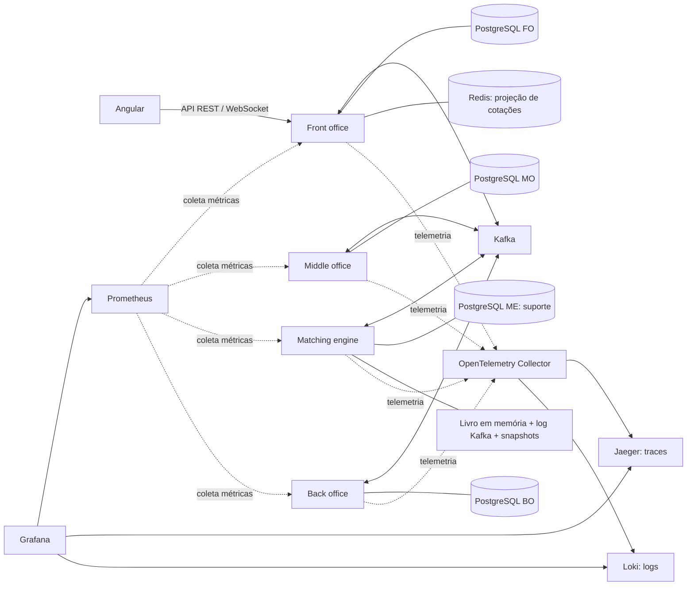

# HLD-001 — Ecossistema Próspero

Data: 2026-10-17. Desenho baseado no [PRD-001](../prds/PRD-001-simulador-prospero.md), ADRs aceitos e manifests/código existentes. A extração não introduz decisões nem torna o destino arquitetural implementado. [Roadmap](../roadmap.md) registra o andamento.

## Objetivo técnico e estado atual

Separar quatro contextos financeiros, demonstrar comunicação assíncrona e permitir operação/testes/observabilidade locais com custo financeiro zero. A fundação contém quatro projetos Quarkus/Java26 e quatro PostgreSQL, Angular, Kafka, Redis e telemetria. As APIs iniciais expõem identidade e saúde técnica; negociação, SAGA, reservas, livro, posições, liquidação e WebSocket permanecem planejados.

A P05 adiciona apenas conversão decimal técnica pura no MO, sem endpoint/regra financeira, integrada ao main pelo PR #3 em 2026-10-17. Isso não implementa validação financeira, risco ou reservas.

## Arquitetura

O [catálogo C4](../c4/README.md) separa contexto de produto planejado, containers da fundação configurada e componentes reais. O [índice de ADRs](../adrs/README.md) registra as substituições frente à proposta original.

O diagrama mostra o destino arquitetural; fluxo financeiro e WebSocket ainda não existem. Na fundação, o Nginx do frontend encaminha consultas técnicas aos quatro serviços. A aplicação de negócio usará o FO como entrada, sem transformar o Angular em orquestrador da negociação.

| Componente | Responsabilidade |
| --- | --- |
| Front office | Receber ordens, persistir sua trajetória, orquestrar SAGA e expor dados ao investidor. |
| Middle office | Validar ordens e limites e reservar/liberar recursos atomicamente. |
| Matching engine | Executar ordens em sequência por ativo, com prioridade preço-tempo e replay determinístico. |
| Back office | Registrar negócios e razão, calcular posições e resultados e simular D+2. |
| Angular | Apresentar operações e estados; hospedar o módulo CLI de testes por planilha. |

Cada microsserviço possui build, imagem, migrações, credenciais e container PostgreSQL próprios. Os demais não acessam seu banco nem sua implementação. A colaboração de negócio ocorre via Kafka; a disponibilidade de todos não é exigida para iniciar cada processo, mas o fluxo ponta a ponta depende de seus participantes.

REST chama Actor; Actor coordena domínio/Helpers puros e repositórios JPA separados. O domínio não conhece HTTP, Quarkus ou JPA. SAGA, outbox e consumidores idempotentes coordenarão o fluxo distribuído. O livro permanece em memória, sem consultar banco por ordem. DDD e Object Calisthenics seguem os [ADRs](../adrs/README.md).

## Fluxos e contratos

Atual: navegador → Nginx/proxy Angular → endpoints `/api/v1/sistema` dos serviços. Cada aplicação verifica suas dependências locais de saúde. O teste de contrato desativa banco/Kafka apenas no perfil de teste; smoke Compose verifica dependências reais.

Planejado: investidor → API FO → registro e SAGA/outbox → Kafka → validação/reserva MO → matching sequencial ME → execução/contabilidade BO → projeções e estados consultáveis no FO/Angular. Representa responsabilidades de destino; nomes de tópicos, esquemas, transições, compensações e garantias de publicação serão definidos nas RFs e não constituem contratos já existentes.

Contratos HTTP de negócio: DTOs, `/api/v1`, Swagger/OpenAPI e status adequados conforme [ADR-003](../adrs/ADR-003-contratos-api.md). `202` não confirma negociação e `204` não contém JSON. Endpoints técnicos Quarkus mantêm caminhos próprios. Frontend não coordena transação financeira nem consulta bancos.

## Dados e consistência

Cada serviço é fonte de verdade de seu contexto e dono de credenciais/migrações Flyway. As migrações atuais só identificam schemas: não há tabelas financeiras. O desenho futuro usa transações locais, outbox, deduplicação e compensações; não existe commit global entre quatro bancos. Reservas requerem proteção atômica local e reconciliação de falhas; timeout sozinho não autoriza liberar recurso quando execução ainda pode ocorrer.

Livro em memória e replay/snapshots são destino do ME; Redis será projeção de mercado, não autoridade para reserva. Quatro bancos independentes não são réplicas. Kafka atual possui broker único KRaft/RF1; consenso/replicação distribuída entre bancos são N/A. Versões reais e adoção ficam em [libs](../libs.md).

## Segurança

Ambiente de estudo, sem dados/operações financeiras reais. Portas publicadas em loopback, configuração sensível local fora do Git e permissões/bancos separados. Não tratar loopback como proteção suficiente para futuras APIs de controle ou negócio. Autenticação/autorização de atores é pendência anterior aos respectivos fluxos; não afirmar RBAC já implementado. Preservar DTOs, limites de entradas e logs sem credenciais. APIs futuras de carga precisam allowlist e limites contra abuso/SSRF.

## Observabilidade e desempenho

Diferentemente da centralização dos três sinais no Collector proposta no PDF (§14), a configuração vigente usa coleta direta de métricas pelo Prometheus. Prometheus coleta métricas das quatro aplicações; OTel envia traces/logs para Jaeger/Loki; Grafana integra fontes. O painel atual é técnico. Traces Jaeger usam memória e não persistem após reinício; demais componentes persistentes usam volumes conforme Compose. Métricas de host/container/DB/Kafka detalhadas ainda exigem coletores e não podem aparecer como zero por ausência de fonte.

A [P06](../roadmap.md) planeja gerador/controlador local limitado e dashboards técnicos, complementares aos quatro de negócio previstos na V01. Sem carga financeira medida. Metas RNF04 permanecem no PRD e exigem hardware, carga, janela e amostras documentados. Labels de métricas devem ter cardinalidade limitada; correlação detalhada fica em logs/traces.

## Escalabilidade, resiliência e implantação

Inicialmente uma stack Compose local; nenhuma promessa de alta disponibilidade, cluster ou escala horizontal validada. ME terá escritor único por ativo e replay determinístico. Integração assíncrona exige tratar atraso e reentrega; não prometer exactly-once fim a fim ou conclusão sem participantes.

Builds independentes por serviço; JDK26 e versões fixadas no ADR-005. Comandos reais e portas no [README](../../README.md), operação na skill subir-sistema e CI no [guia](../rules.md#ci-e-runner). CI remota depende de runner dedicado; checks locais não comprovam execução GitHub. Flyway evolui cada banco sem acesso a tabelas de outro serviço. Não executar limpeza destrutiva de volumes para iniciar/validar.

## Riscos, trade-offs e decisões

| Risco / trade-off | Tratamento |
| --- | --- |
| Quatro bancos e telemetria elevam RAM/CPU local | Preflight e limites; não concorrer com stress de outros projetos, preservar Horus. |
| Eventos geram atraso, duplicidade e contratos coordenados | Estados explícitos, testes de reentrega e implementação futura de outbox/deduplicação. |
| Regras financeiras ainda abertas | Definir escalas, calendários e concorrência antes das tarefas dependentes. |
| Observabilidade ou gerador saturados distorcem medições | Orçamento conjunto e métricas separadas; não comprovar capacidade com endpoint de identidade. |

Decisões: [ADR-001 backend/fronteiras](../adrs/ADR-001-arquitetura-backend.md), [ADR-002 padrões](../adrs/ADR-002-padroes-dominio.md), [ADR-003 HTTP](../adrs/ADR-003-contratos-api.md), [ADR-004 testes](../adrs/ADR-004-testes-planilha.md) e [ADR-005 versões](../adrs/ADR-005-versoes-fundacao.md). Aceita não significa implementada; evolução incompatível exige substituição explícita. Novas decisões da carga serão avaliadas na P06.

## Verificação e rastreabilidade

Fundação: P02 e suas [evidências — histórico Git](https://github.com/mclovin137/Prospero/blob/bd707fa972aa36c6811fa00d13ad73c3073721c1/docs/evidencias/P02-testes.md). Invariantes de precisão técnica: P05 integrada pelo PR #3. Produto financeiro: RF01–RF10/P03 ainda planejados; validação final em V01. Atualizar este HLD quando mudar componente, integração ou fluxo; gerar C4 pelo [perfil local](../agentes/c4-diagram-generator.md) quando ajudar, sem inventar níveis.

## HLDs dos contextos

| Contexto | Desenho detalhado |
| --- | --- |
| Front office | [HLD-002](HLD-002-front-office.md) — entrada, ordens e SAGA |
| Middle office | [HLD-003](HLD-003-middle-office.md) — validação, risco e reservas |
| Matching engine | [HLD-004](HLD-004-matching-engine.md) — livro, sequência e recuperação |
| Back office | [HLD-005](HLD-005-back-office.md) — negócio, razão, posição e D+2 |

## Stack transversal e Angular

Versões configuradas: Java26/Quarkus3.40.1 e PostgreSQL16 para cada MS, Kafka4.1.0/KRaft, Redis8.2.2, Angular22.2.3/TypeScript6/RxJS7/Node24 e Nginx. OpenTelemetry Collector, Loki, Prometheus, Grafana e Jaeger compõem a telemetria. O [inventário](../libs.md) registra versões exatas, resolvidas e overrides; Dockerfiles/POMs/lockfile/Compose são evidência da adoção.

Angular hoje exibe identidade/saúde dos serviços, com proxy Nginx para as APIs técnicas. Boleta, livro, ordens, posição e tempo real são destino. Signals/RxJS suportam apresentação; WebSocket pelo FO ainda será definido. Runner XLSX será módulo CLI no projeto frontend, sem testar pelo DOM nem acessar bancos; parser e formato permanecem P03. UI tem testes de componentes e E2E conforme [roadmap Angular](../../frontend/ROADMAP.md).

## Catálogo de eventos: referência ainda não contratada

| Nome citado na proposta histórica | Chave sugerida | Papel futuro |
| --- | --- | --- |
| ordens.comandos | Ativo | Sequenciar comandos do matching |
| mercado.negocios | Ativo | Negócios executados |
| posicoes.eventos | Conta | Atualização de posição |
| mercado.precos | Não definida | Cotações e projeções |

Nomes são candidatos históricos, não tópicos/aplicações implementados nem contrato aprovado por este HLD. Antes de criar: definir produtor/consumidor, schema/envelope/versionamento, IDs/correlação/traceparent, chave, retenção, ordering, retries e política para mensagens inválidas. Definir como transitar da ordem por ativo para a ordem por conta sem afirmar ordem global Kafka. Correlação deve sobreviver a múltiplas execuções de uma ordem.

## Continuidade e evolução

Banco por serviço, volumes e Kafka com retenção não comprovam backup/restauração ensaiados. Recuperação de negócio exige testes específicos em cada HLD; não confundir a recuperação já verificada da ferramenta ai-memory com a financeira. Não há serviço externo real ou fornecedor pago.

Estudos úteis: liquidez/impacto/slippage, estruturas ordenadas/FIFO, concorrência e determinismo, consistência/transações, DDD e telemetria. Melhorias históricas como JMH/async-profiler, ZGC, HMAC/mTLS/Argon2, arquivamento frio, réplicas ou jobs especializados ficam como alternativas futuras, sem adoção ou custos implícitos. Desenho de segurança/capacidade adicional só quando necessário pelo guia documental.

A documentação histórica permanece no Git e nos PRs ligados pelo roadmap; PRD, HLDs e ADRs são as referências vigentes. Não duplicar relatórios no checkout.
