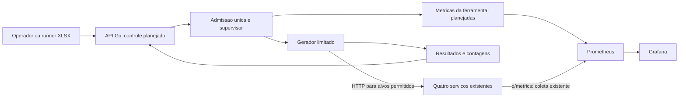

# HLD-006 — API de testes de carga em Go

Data: 2026-10-17. Requisito: [P06](../roadmap.md#p06--api-de-carga-progressiva-e-observabilidade), habilitando RNF04/RNF07 e a V01 do [PRD](../prds/PRD-001-simulador-prospero.md). Decisão: [ADR-006](../adrs/ADR-006-api-carga.md).

## Objetivo e estado

Controlar execuções locais de carga por API, com rampas, cancelamento, resultados reproduzíveis e recursos do gerador observáveis separadamente dos quatro serviços medidos. **Go foi aprovado pelo usuário.** Este HLD descreve o desenho e a pesquisa de alternativas; não há API, módulo Go, container, porta ou painel P06 implementado nesta entrega. Framework e motor continuam recomendações para validação técnica, não dependências instaladas.

Etapa A mede endpoints técnicos existentes, inicialmente `GET /api/v1/sistema` dos quatro serviços. Etapa B incorpora cenários financeiros depois das RFs/P03, com preparação e limpeza exclusivamente por APIs. Identidade HTTP não mede boleta → negócio ou matching; não comprova RNF04. O desenho complementa os quatro dashboards financeiros da V01, sem substituí-los ou reduzir o aceite da P06.

## Contexto, fronteiras e componentes

Ferramenta técnica opt-in, fora dos processos Java e dos bancos financeiros. Não é quinto contexto de negócio. Não acessa PostgreSQL, Kafka ou Redis, não recebe socket Docker e não interfere no Horus. O operador fornece um plano declarativo; destinos, método e rota vêm de catálogo interno permitido. A integração financeira entre os quatro MS permanece Kafka.



Fluxo de responsabilidades, não diagrama de implantação existente. Se API e gerador compartilharem processo, CPU/RSS/heap desse processo representam ambos; não serão anunciados como duas medições independentes.

| Componente proposto | Responsabilidade | Limite |
| --- | --- | --- |
| API de controle | Autenticação, DTOs, OpenAPI, validação e acompanhamento | Não executa comandos nem aceita código, URL ou headers livres |
| Admissão/supervisor | Reserva atômica de uma execução, contexto próprio, deadlines e término | Sem fila de execuções ou reinício automático |
| Gerador | Calendário de oferta ou VUs, transporte limitado e observações | Fora dos processos medidos; concorrência e tráfego limitados antes de criar trabalho |
| Resultados | Contagens, duração, distribuições e metadados do ambiente | Retenção por prazo, quantidade e bytes; sem corpos ou credenciais |
| Instrumentação | Métricas cumulativas da ferramenta e correlação sanitizada | IDs de execução não entram nas labels |

Esses blocos não obrigam pacotes/interfaces ou processos separados para cada função. Localização candidata: módulo Go independente em `ferramentas/carga/`; diretório e layout só existirão com a implementação.

## Pesquisa de frameworks HTTP

A API de controle é pequena; o desempenho do roteador não representa a capacidade do gerador ou do sistema. Recomendação inicial: **`net/http` + Huma com adaptador `humago`**. Validar o contrato em experimento curto antes de instalar dependências; a escolha não está sendo atribuída ao usuário.

| Alternativa | Como ajuda | Trade-off neste módulo |
| --- | --- | --- |
| `net/http` / `http.ServeMux` | Servidor, cliente, métodos e parâmetros de rota na biblioteca padrão; baseline com poucas dependências | DTOs/erros/OpenAPI precisariam ser mantidos explicitamente sem camada adicional. [Go HTTP](https://pkg.go.dev/net/http), [roteamento](https://go.dev/blog/routing-enhancements) |
| Huma + `humago` | Contratos tipados, OpenAPI/JSON Schema, validação e erros; integra com ServeMux | Camada de contrato sobre o roteador, não outro motor HTTP. Limites e sanitização continuam responsabilidade local. [Adaptadores](https://huma.rocks/features/bring-your-own-router/), [validação](https://huma.rocks/features/request-validation/) |
| chi + Huma ou DTOs próprios | Composição de rotas/middlewares compatível com `net/http` | Adotar somente se ServeMux não atender à composição necessária; não empilhar roteadores por hábito. [chi](https://github.com/go-chi/chi) |
| Gin | Binding, roteamento e middleware de API | É alternativa viável, mas não há necessidade demonstrada de sua superfície adicional. [Gin](https://gin-gonic.com/en/docs/) |
| Fiber | API própria e ecossistema baseado em fasthttp | A semântica de contexto difere: `fiber.Ctx` não fornece cancelamento e é reutilizado. Exige contexto próprio e prova de término; sem benefício local medido que justifique essa adaptação. [Fiber Ctx](https://docs.gofiber.io/api/ctx/) |

Huma exige configuração explícita: rejeitar queries desconhecidas (`RejectUnknownQueryParameters`), conservar schema estrito e não desativar validação das operações. O modelo de erro pode transportar `value` recebido; retirar valores sensíveis antes de responder/logar. Definir limites de body, headers e leitura no servidor, além dos [limites por operação](https://huma.rocks/features/request-limits/). Mapear [erros Huma](https://huma.rocks/features/response-errors/) para o catálogo/Problem Details do ADR-003, incluindo `Cache-Control: no-store`.

Consulta oficial em 2026-10-17: [Huma v2.39.1](https://github.com/danielgtaylor/huma/releases/tag/v2.39.1), [chi v5.5.0](https://github.com/go-chi/chi/releases/tag/v5.5.0) e [k6 v2.3.0](https://github.com/grafana/k6/releases/tag/v2.3.0). São referências da pesquisa, não versões adotadas ou prova de ausência de vulnerabilidades. Fixar toolchain, módulos, transitivas e imagens após revisão, antes do código que os utilizar.

## Pesquisa do motor de carga

Comparar um motor reutilizado com um esqueleto nativo restrito contra o mesmo alvo HTTP descartável. Não construir quatro adaptadores completos nem uma plataforma de benchmark permanente. A escolha depende de limites observáveis, fidelidade da oferta, término e custo de adaptação; nenhum ensaio foi executado nesta pesquisa.

| Motor | O que reaproveita | O que precisa ser demonstrado |
| --- | --- | --- |
| [Vegeta como biblioteca Go](https://pkg.go.dev/github.com/tsenart/vegeta/v12/lib) | Geração orientada a taxa, pacer, workers e resultados sem processo externo | Não confundir limitação de corpo retido com tráfego lido. Na [revisão consultada](https://github.com/tsenart/vegeta/blob/647dacca770d33913c1b0695b3b71ba261bd341d/lib/attack.go), `MaxBody` limita retenção e depois há drenagem via `io.Copy`; `Stop` sinaliza parada, sem provar aborto das chamadas em voo. Conferir também comportamento ao atingir workers máximos e contabilizar ofertas perdidas |
| [k6 local supervisionado](https://grafana.com/docs/k6/latest/using-k6/scenarios/concepts/open-vs-closed/) | Executores abertos/fechados e métricas maduras | Processo/binário adicional, adaptação de resultados e limites, scripts fixos, ambiente restrito e término sem órfãos. [v2 remove controles legados](https://github.com/grafana/k6/releases/tag/v2.0.0); não depender de pause/resume/scale/status antigos |
| [Fortio](https://github.com/fortio/fortio) | Biblioteca/ferramenta Go com carga HTTP e histogramas | Verificar modelos de chegada, contagens, bytes e cancelamento; sua UI/API genérica não deve ser exposta como controle livre do Próspero |
| Executor nativo restrito em Go | Controle direto de calendário, requisições, contagens e encerramento, sem runtime de scripts | Manter e testar agendamento, transporte e estatística; não pressupor precisão por ser código próprio |

Critérios eliminatórios comuns: teto real de bytes durante leitura, inclusive resposta chunked; aborto em voo; nenhuma rajada de recuperação; contagens reconciliáveis; limites de recursos; ausência de execução/URL livre. Se a adaptação de uma ferramenta não cumprir esses critérios de forma proporcional, justificar o executor nativo no ADR antes de adotá-lo. Nenhum motor está escolhido por este HLD.

## Fluxo e contratos candidatos

1. Autenticar, limitar entrada e validar o plano inteiro e o preflight antes de gerar tráfego.
2. Reservar atomicamente a única execução; recusar um pedido concorrente com `409`, sem segunda geração.
3. Responder `202` com ID e `Location`; o supervisor passa a possuir contexto independente do POST. O retorno do handler não cancela uma execução aceita.
4. Executar aquecimento/medição com calendário e limites declarados; registrar resultados sem armazenar payloads.
5. Encerrar a oferta, drenar ou abortar em prazo limitado, aguardar tarefas/processo e consolidar contagens. Só então liberar a execução global.

| Interface proposta | Resposta principal | Regras |
| --- | --- | --- |
| `POST /api/v1/execucoes-carga` | `202`, ID e `Location` | Plano declarativo validado, catálogo interno de alvos, uma execução global |
| `GET /api/v1/execucoes-carga/{id}` | `200` com estado/relatório | `404` para ID desconhecido/expirado; inclui identidade da instância |
| `POST /api/v1/execucoes-carga/{id}/cancelamentos` | `202` enquanto encerra; `200` se já terminal | Efeito idempotente; preserva o relatório, não apaga histórico |
| OpenAPI e métricas técnicas | Schema / scrape | Caminhos/exposição ainda a fixar; métricas sem credencial de controle compartilhada |

Autenticação ausente/inválida usa `401`; origem ou permissão recusada, `403`; estrutura malformada, `400`; violação semântica, `422`; limitação administrativa, `429`; preflight ausente/vencido/insuficiente, `503`, sem início. Catálogo estável de códigos, DTOs e headers será fixado junto à implementação, incluindo mapeamento dos defaults do framework.

Plano: modo aberto/fechado, serviço/rota enumerados, estágios, duração, teto de chamadas/concorrência, aquecimento e parâmetros de medição. Não recebe host, porta, URL, script, comando, arquivo ou header arbitrário. Credenciais de cenários financeiros futuros terão contrato próprio; não repassar o bearer administrativo ao alvo.

Estado candidato: `AGUARDANDO` (admissão reservada, sem fila) → `EXECUTANDO` → `ENCERRANDO` → `CONCLUIDA`, `CANCELADA` ou `FALHA`. Cancelamento repetido e corrida com término retornam o mesmo estado real. Erro HTTP de amostra não implica falha do supervisor nem sucesso financeiro.

## Técnicas de execução, backpressure e precisão

- **Contextos e tarefas:** `context` por execução e por requisição; cancelamento propagado até conexão/leitura, seguido de espera pelo término. `errgroup` é candidato para tarefas do ciclo de vida; um erro HTTP esperado vira amostra, não erro fatal que cancela toda a carga. `Go` com limite pode bloquear; [TryGo](https://pkg.go.dev/golang.org/x/sync/errgroup) ou admissão equivalente evita fila oculta.
- **Modelo aberto:** planejar instantes por relógio monotônico independentemente da resposta. Oferta vencida ou sem capacidade é não iniciada/descartada; não acumular trabalho nem recuperar atrasos em rajada. Medir atraso do agendador separado do tempo HTTP.
- **Modelo fechado:** VUs limitados aguardam sua iteração; impor também teto de RPS/chamadas, com pacing declarado. Lentidão reduz chegada; VUs não equivalem a usuários autenticados. [Modelos k6](https://grafana.com/docs/k6/latest/using-k6/scenarios/concepts/open-vs-closed/).
- **Teto de segurança:** [x/time/rate](https://pkg.go.dev/golang.org/x/time/rate) implementa token bucket. `Allow` rejeita sem espera; `Wait`/reservas alteram o tempo de oferta. O limiter não substitui o agendador, e burst deve estar explicitamente limitado.
- **Transporte:** cliente e pool reutilizados, proxy do ambiente desabilitado, redirects recusados, limites de requisições/conexões/ociosidade e deadlines. Contar bytes conforme chegam e interromper leitura ao exceder teto; `Content-Length` não basta. Desabilitar descompressão automática no baseline e recusar conteúdo comprimido não previsto; se adicionado depois, limitar tanto bytes comprimidos quanto expandidos. Conferir retries internos do transporte/motor e distinguir tentativa de iteração; não anunciar ausência de retry sem teste. [HTTP Go](https://pkg.go.dev/net/http).
- **Tempo e números:** durações monotônicas e timestamps UTC para correlação. API pode expor contadores e durações em microssegundos inteiros; taxas derivadas como strings decimais para compatibilidade com o runner P03. Métricas técnicas em ponto flutuante não autorizam `double` financeiro.

Proposta de contabilidade sem sobreposição:

```text
oferecidas = iniciadas + naoIniciadas
naoIniciadas = descartadasPorAtrasoOuCapacidade + interrompidasAntesDeIniciar
iniciadas = finalizadas + emVoo
finalizadas = respostasHTTP + timeouts + falhasTransporte + canceladasEmVoo + limitesResposta
```

Cada amostra terminal recebe uma categoria exclusiva. Erros HTTP são subconjunto de respostas HTTP; não somá-los novamente. No relatório final, `emVoo = 0`; conservar separadamente a oferta prevista de fases que nem começaram. Em modo fechado, oferta efetiva não deve ser comparada como se existisse um calendário RPS aberto.

Relatório conserva oferecida/atingida por janela, erros, descartes, atraso do gerador e distribuição HTTP. Registrar início/fim da medição, aquecimento, relógio, população, denominadores e tratamento de falhas/timeouts. Preferir todas as durações quando o teto absoluto permitir; escolher algoritmo de quantil, resolução e buckets antes da implementação. p50/p95/p99/máximo não podem ocultar falhas ou espera do agendador. Histogramas Prometheus geram quantis aproximados; não apresentá-los como percentis exatos do relatório.

## Dados, retenção e recuperação

Registros: plano aceito, identidade da instância/execução, estados/instantes, observações de recursos, contagens e resultado agregado. Proposta inicial de histórico volátil limitado a 20 execuções/20 minutos, com teto adicional de bytes; execução ativa não é eliminada por expiração. Nenhum banco/Redis ou fila distribuída é necessário por antecipação.

Reinício perde histórico volátil e nunca repete tráfego. A identidade da instância permite reconhecer que um ID anterior não pertence ao processo atual; não prometer recuperação de resultado perdido. Se persistência tornar-se necessária, rever contrato e ADR, sem gravar em banco financeiro. Logs limitados não substituem histórico durável.

Shutdown e cancelamento param oferta, abortam chamadas e aguardam tarefas. Motor em subprocesso exige binário/argumentos fixados, sem shell, ambiente permitido, stdout/stderr limitados e mecanismo de término junto ao supervisor mesmo sob morte abrupta. Se o encerramento não for comprovado, recusar novas execuções e falhar explicitamente; nunca marcar sucesso só por ter enviado um sinal.

## Desempenho com falhas e consistência entre serviços

Objetivo adicional solicitado pelo usuário: sob alta oferta e indisponibilidade de um participante, verificar ausência de perda das operações aceitas duravelmente e de duplicação dos efeitos, com convergência após recuperação. Isso é **aceite futuro**, dependente dos contratos financeiros/RFs; não é garantia já demonstrada pela fundação. HTTP recebido, operação persistida, evento publicado e negócio concluído são marcos diferentes. Timeout deixa resultado desconhecido até consulta/reconciliação por identidade estável; retries exigem contrato de idempotência, sem inventar novos IDs para a mesma intenção.

Estratégia do [ADR-002](../adrs/ADR-002-padroes-dominio.md): estado e outbox na mesma transação local; relay só avança após confirmação de publicação; falha entre publicação e marcação permite reentrega. Consumidor deduplica na mesma transação dos efeitos e confirma offset após persistência. SAGA mantém pendências recuperáveis; timeout isolado não libera reserva e negócio efetivado se recupera para frente. ME precisa protocolo próprio de log/snapshot/offset e publicação abortada, conforme RF05. Isso admite entrega pelo menos uma vez; idempotência do produtor não é exatamente uma vez de ponta a ponta.

O harness operacional externo, com lista fechada de recursos do projeto e restauração em caso de erro, controla interrupção/retorno. A API Go só oferece carga/consulta/cancelamento; nenhuma rota executa shell, mata MS ou recebe socket Docker. A execução XLSX continua exclusivamente via APIs. Falhas são ensaiadas em ambiente isolado com dados sintéticos e orçamento aprovado, sem apagar volumes nem afetar outros projetos.

| Cenário futuro | Verificação além da vazão HTTP |
| --- | --- |
| Rampa sem falha e saturação | Oferta versus admissão versus conclusão; descartes, filas, cauda de latência, CPU/GC/I/O e interferência do gerador |
| MO/ME/BO indisponível durante carga | Operações elegíveis permanecem pendentes ou são rejeitadas conforme contrato; não concluir sem participante nem criar retry ilimitado |
| FO cai após commit e antes de responder | Consulta por identidade recupera resultado; repetição idempotente não cria segunda intenção/reserva |
| Relay cai depois de publicar; consumidor cai depois do commit e antes do offset | Reentrega não duplica negócio, lançamento, posição ou reserva; nenhuma intenção confirmada desaparece |
| Participante retorna com backlog | Drenagem limitada e progresso observável; medir tempo de recuperação e operação mais antiga, sem rajada descontrolada |
| Kafka único para/reinicia | Publicação falha ou fica pendente; observar recuperação com dados retidos, sem alegar failover |
| Kafka replicado futuro perde um broker/ISR fica insuficiente | Conferir configuração efetiva; manter escrita somente com ISR suficiente, recusar confirmação quando insuficiente e recuperar pendências |

Oráculo por APIs: conjunto de IDs aceitos duravelmente = IDs em estado terminal válido + IDs ainda pendentes, sem sobreposição; ao fim do prazo de reconciliação, nenhum pendente inesperado. Erros de rede com resultado desconhecido são reconciliados antes dessa classificação. Conferir quantidades enviadas/executadas/canceladas/em aberto, reservas versus resultado efetivo, negócios únicos, lançamentos balanceados e posições derivadas dos negócios, conforme regras que as RFs aprovarem. Projeções têm atraso medido e prazo explícito; divergência temporária não equivale a perda. Lag zero sozinho não prova consistência.

Relatório registra seed/dados, IDs sintéticos limitados, falhas e horários, versões/configuração, ofertas/aceites/conclusões, maior idade da pendência, backlog, erros e reconciliação. Prazo de recuperação e limites de backlog serão definidos antes do experimento; excedê-los é falha, sem declarar integridade apenas por ausência de erro HTTP. Nenhum cenário financeiro/falha foi executado nesta entrega.

### Destaque: WAL, fsync e group commit

> **Dimensionar armazenamento antes de prometer TPS.** Com `fsync=on` e commit síncrono local, a confirmação aguarda a sincronização do WAL com armazenamento durável pelo método configurado, não necessariamente uma chamada literal `fsync`. Não desligar durabilidade para melhorar o benchmark. Registrar valores efetivos de `fsync`, `synchronous_commit`, `full_page_writes` e `wal_sync_method`. [PostgreSQL 16 — WAL](https://www.postgresql.org/docs/16/runtime-config-wal.html).

Para uma conexão com commits sequenciais, dominados por um flush de **0,55 ms**, `1 / 0,00055 ≈ 1.818 commits/s` é apenas teto aritmético simplificado. Não é medição do Próspero nem propriedade de todo SSD SATA; execução, rede e outros custos reduzem a vazão. Com concorrência, group commit pode compartilhar um flush entre commits; a escala pode parar em CPU, I/O, locks, pool ou replicação. [Group commit](https://www.postgresql.org/docs/16/wal-configuration.html).

Duzentas conexões não garantem 20.000 operações/s. Variar uma dimensão por vez: oferta, concorrência efetiva/pool e lotes limitados do relay. Aumentar pool sem diagnóstico pode piorar contenção; lotes alteram latência, retenção e recuperabilidade. Medir espera do pool, transações/s versus ordens/s, WAL/flush, locks, CPU e idade da outbox; uma ordem pode exigir vários commits. Manter garantias iguais nas comparações.

> **EBS/Persistent Disk e NVMe local precisam ser medidos no armazenamento real do WAL.** Discos em rede podem ter latência de sincronização maior; tipo de volume, provisionamento, VM e fila mudam o resultado. Não extrapolar de marca, de benchmark de outro host ou do filesystem do container. [EBS](https://docs.aws.amazon.com/ebs/latest/userguide/ebs-io-characteristics.html), [Persistent Disk](https://docs.cloud.google.com/compute/docs/disks/performance).

Planejar `pg_test_fsync` como diagnóstico separado, em arquivo de teste exclusivo no mesmo filesystem/dispositivo efetivo do WAL, com espaço/orçamento limitado. Nunca apontar para arquivo WAL/dados existente; não executar carga no volume ativo para esta pesquisa. Registrar versão, método, localização e latências. A ferramenta compara sincronizações, não mede TPS financeiro nem prova resistência a perda de energia. [pg_test_fsync 16](https://www.postgresql.org/docs/16/pgtestfsync.html).

### Kafka: replicação não é fsync por mensagem

Kafka normalmente usa page cache e flush do sistema operacional, sem fsync por mensagem; sua estratégia usual de durabilidade combina replicação e configuração de confirmação. Uma falha correlacionada que perca todas as cópias ainda pode perder dados não persistidos. [Kafka — hardware e SO](https://kafka.apache.org/41/operations/hardware-and-os/).

Perfil **proposto para ensaiar replicação**, sujeito a orçamento/topologia: três brokers, tópicos de negócio com fator 3, `min.insync.replicas=2`, produtor com `acks=all` e `enable.idempotence=true`, configurações compatíveis de retries/ordenação e eleição não limpa desabilitada. `acks=all` aguarda as réplicas atualmente em ISR; mínimo 2 impede novas confirmações quando ISR cai abaixo de 2. Com RF3, perder um broker pode preservar escrita com dois em ISR; duas cópias vivas isoladamente não bastam sem líder/quórum/rede operacionais. Confirmar também topologia dos controllers. [Produtor](https://kafka.apache.org/41/configuration/producer-configs/), [tópicos](https://kafka.apache.org/41/configuration/topic-configs/).

**Hoje:** Compose usa um broker/controller KRaft e replicação interna/mínimo de ISR transacional 1; não há tópicos/produtores de negócio implementados nem evidência de configuração `acks=all`/idempotência de negócio. Aplicar mínimo 2 ao broker único impediria produção, sem criar redundância. Perfil replicado exige decisão e infraestrutura futuras; bancos separados não são réplicas. Outbox/deduplicação continuam necessários mesmo nesse perfil.

### Alocação e pausas Java

A P06 deve correlacionar alocação estimada, dados vivos, heap/RSS, pausas/safepoints, CPU/throttling e latência da aplicação. Centenas de MB/s é hipótese de carga, não medição existente. A comparação G1/Parallel/ZGC e o protocolo estão no [ADR-007](../adrs/ADR-007-coletor-gc.md); G1 é baseline proposto, sem trocar flags ou declarar benefício sem teste. O GC de Go será medido separadamente e não usa flags da JVM.

## Segurança, implantação e orçamento

Ferramenta proposta em Compose opt-in, usuário sem privilégios, filesystem somente leitura, tmpfs/PIDs/logs limitados e publicação exclusivamente loopback. Não há serviço/porta P06 vigente para documentar como comando executável. Sem mounts de bancos, HOME, socket Docker ou ambiente do host. Não contratar infraestrutura nem interromper projetos alheios para obter orçamento.

JWT bearer de controle com **HS256 fixado no servidor**, rejeitando `none` e qualquer outro algoritmo; header do token não seleciona algoritmo/chave arbitrários. Verificar assinatura, emissor/audiência esperados, `exp`, `nbf` quando presente e permissões; segredo aleatório de pelo menos 256 bits externo ao Git/imagem, com rotação definida antes de implementação. Ausência de segredo impede inicialização. [RFC 8725](https://www.rfc-editor.org/rfc/rfc8725.html). Autenticação antes de parsing custoso, validação de Host/Origin e política de navegador explícita; CLI sem Origin continua autenticada. Sem confiança implícita em proxies/headers encaminhados. Limitar chamadas administrativas e execuções consecutivas, não apenas simultaneidade. Erros/logs não incluem tokens, corpos ou valores sensíveis refletidos pelo framework.

A demonstração de biblioteca mal configurada fica restrita a exemplo isolado com dados sintéticos ou teste negativo; nenhuma opção de UI, rota ou flag do serviço permite aceitar `none` ou pular assinatura. Testar o middleware real: token ausente/adulterado/expirado, algoritmo ausente/divergente/`none`, emissor/audiência incorretos e `nbf` futuro resultam em `401` e zero tráfego/admissão; permissão insuficiente resulta em `403`. Autenticação JWT está planejada, não implantada hoje.

Preflight é operação confiável no host, com origem, instante e validade, conferindo RAM disponível, CPU/quota, disco e telemetria/gerador. O controlador isolado não deve atribuir métricas próprias ao host. O mecanismo de entrega/verificação da autorização fresca de preflight precisa ser definido e testado antes de habilitar início via API; não aceitar número de RAM enviado por cliente arbitrário como prova de orçamento.

Orçamento candidato para experimento, **ainda não medido**: container de 384 MiB/1 CPU; até cinco estágios; até 60 s de oferta, drenagem de até 2 s e prazo total de até 62 s; 100 RPS, 16 VUs, 32 chamadas em voo, 6.000 chamadas totais, 64 KiB por resposta e timeout de 2 s. Aquecimento faz parte do orçamento de oferta e do total de chamadas, mas não da população de latência de medição. Valores devem ser verificados conjuntamente; os 4096 MiB do preflight de CI não são aceite automático para este orçamento.

## Observabilidade: fontes reais e implantação futura

| Sinal | Fonte atual ou proposta | Limite de interpretação |
| --- | --- | --- |
| Disponibilidade/HTTP/JVM dos MS | Prometheus já consulta `/q/metrics`; painel atual usa `up` | Inventariar séries reais antes de escrever PromQL; scrape bem-sucedido não é negociação pronta |
| Oferta/execução/erro/latência/atraso | Instrumentação Go proposta com [client_golang](https://pkg.go.dev/github.com/prometheus/client_golang/prometheus) | Cumulativos do processo separados dos resultados por execução; sem resets por run nas séries cumulativas |
| CPU/RSS/heap/GC/goroutines | Coletores do processo e [runtime/metrics](https://pkg.go.dev/runtime/metrics), propostos | Se processo for compartilhado, números representam API+gerador; cgroup limita container, não elimina interferência do host |
| Disco/rede/FDs/pools/host/container/DB/Kafka | Selecionar coletores e permissões conforme cada fonte | Não há coleta detalhada demonstrada hoje; ausência permanece explícita. Não adicionar socket ou modo privilegiado para completar painel nominalmente |
| Logs/traces | `log/slog` e instrumentação Go/OTel a avaliar contra Collector existente | Amostragem/retenção limitadas; não exportar corpo/token nem medir tracing como se fosse custo zero |

Labels finitas: serviço/rota/método/status/fase. Execução/usuário/conta não são labels. Métricas podem ser internas à rede de telemetria sem compartilhar bearer administrativo com Prometheus. O scrape atual de 15 s pode perder fases curtas: preservar resultado final independente do scrape e escolher janela específica com orçamento explícito. Dados ausentes não são substituídos por zero.

## Plano de verificação e evolução

| Alegação | Evidência exigida antes de concluir implementação |
| --- | --- |
| Contrato/controlador seguro | `httptest`, schema/OpenAPI, credenciais/Origin/Host, limites, início concorrente e token sentinela ausente de artefatos |
| Modelos corretos | Relógio/transporte controlados, alvo lento, pacing, atraso, saturação e conservação de contagens |
| Bytes e cancelamento limitados | Resposta chunked/contínua/excessiva/comprimida, proxy/redirect, cancelamento durante conexão/leitura e ausência de tráfego após término |
| Recuperação honesta | Morte abrupta, reinício sem replay, identidade de instância, retenção e nenhuma execução órfã |
| Medição reproduzível | Hardware, limites, aquecimento, população, amostras, quantis e custo do gerador registrados; comparar métricas ao relatório |
| Integração API/P03 | Workbook inicia, captura ID, consulta até terminal, verifica rejeições/cancelamento e limpa apenas seus recursos por API |

Ferramentas de desenvolvimento candidatas: `testing`/`httptest`, [race detector](https://go.dev/doc/articles/race_detector), [fuzzing](https://go.dev/doc/security/fuzz/) para plano/limites e [govulncheck](https://go.dev/doc/security/vuln/) sobre versões fixadas. Executar benchmarks só após definir hipótese e ambiente; não usar benchmark de roteador publicado por terceiros como capacidade local.

Próxima sequência: experimento limitado de contrato e motor → registrar escolhas/versões e preflight → implementar admissão/supervisão/transporte/contagens → resultados e métricas reais → Compose/painéis → XLSX e baseline curto → revisão independente. A escolha técnica não exige repetir a pergunta Go/Rust já respondida. PRD e metas permanecem iguais; ajustes proporcionais ficam neste HLD, ADR-006, inventário e P06. Nesta entrega foram feitos pesquisa e revisão documental, sem build Go, carga ou benchmark.
