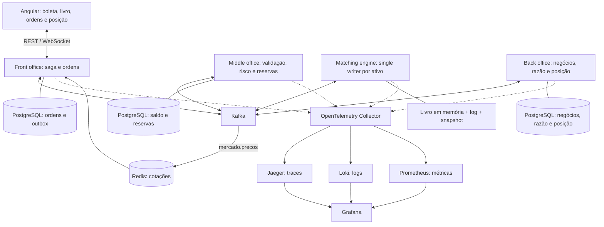

# Prospero — Arquitetura e requisitos

> **Decisões posteriores — 16/10/2026:** este documento conserva a proposta original. A arquitetura vigente adota **Quarkus, Java 26 e JPA**, quatro containers PostgreSQL isolados, Helpers puros separados dos repositórios e testes por planilha via API. Os trechos sobre Spring/JDBC, Java 25, caminhos de pacotes e execução do planejamento inicial foram substituídos pelos [ADRs](docs/adrs/README.md). Consulte as [regras](docs/rules.md), o [inventário](docs/libs.md) e o [roadmap atual](docs/roadmap.md). RF01–RF10 e RNF01–RNF08 permanecem como referência; tecnologias planejadas não significam funcionalidades implementadas.

> Fonte: [prospero-arquitetura.pdf](prospero-arquitetura.pdf), versão 1.0, de 13/10/2026, autor Cristóvão. Documento original gerado pelo Caderno de Ciência da Computação a partir do construtor de arquitetura.
>
> Esta versão organiza o conteúdo das 14 páginas físicas do PDF para consulta e desenvolvimento. As seções 1–14 consolidam a proposta original; a seção 15 contém análise e pendências acrescentadas nesta conversão. Tecnologias, caminhos e entregáveis representam a arquitetura planejada, não funcionalidades já implementadas. As versões tecnológicas foram transcritas, sem revisão de atualização ou compatibilidade.

## Sumário

1. [Escopo](#1-escopo)
2. [Atores](#2-atores)
3. [Requisitos funcionais](#3-requisitos-funcionais)
4. [Requisitos não funcionais](#4-requisitos-não-funcionais)
5. [Tecnologias](#5-tecnologias)
6. [Arquitetura](#6-arquitetura)
7. [Modelo de dados](#7-modelo-de-dados)
8. [Padrões de projeto](#8-padrões-de-projeto)
9. [Tópicos de estudo](#9-tópicos-de-estudo)
10. [Estratégia de testes](#10-estratégia-de-testes)
11. [Riscos e mitigações](#11-riscos-e-mitigações)
12. [Melhorias opcionais](#12-melhorias-opcionais)
13. [Roteiro de desenvolvimento](#13-roteiro-de-desenvolvimento)
14. [Estrutura de código prevista](#14-estrutura-de-código-prevista)
15. [Análise e pendências para implementação](#15-análise-e-pendências-para-implementação)

## 1. Escopo

Mercado financeiro simulado, pequeno e profundo, com **cinco ações fictícias**, um livro de ofertas por ativo e participantes humanos e simulados. O objetivo é demonstrar como o encontro de ordens forma preços e como uma ordem percorre front office (FO), middle office (MO), matching engine (ME) e back office (BO).

O investidor acompanha preço, bid, ask, spread e profundidade; envia ordens Market, Limit, Stop e Stop Limit, com Stop Loss e Take Profit opcionais; acompanha execuções parciais ou totais, posição comprada ou vendida, preço médio e P&L realizado e não realizado. O MO valida e reserva recursos antes do matching. O BO registra negócios, mantém histórico, recalcula posições e simula liquidação em D+2.

A pouca quantidade nos melhores níveis pode fazer uma ordem pequena mover bastante o preço. Esse efeito deve ser visível de ponta a ponta, com traces no Jaeger e painéis no Grafana. O projeto também serve como demonstração técnica para entrevistas em bancos, corretoras e fintechs.

### Limites e simplificações

| Tema | Escopo do projeto |
| --- | --- |
| Ativos e dados | Cinco ativos fictícios; sem dados reais de mercado. |
| Participantes | Investidor e formadores de mercado simulados. |
| Negociação | Livro contínuo; sem leilões de abertura/fechamento, circuit breaker de bolsa ou iceberg. |
| Roteamento | Sem múltiplas bolsas ou roteamento inteligente. |
| Venda a descoberto | Simulada com limite; sem aluguel real de ações. |
| Custos | Sem corretagem, emolumentos ou impostos. |
| Protocolos | Sem FIX ou UMDF. |
| Stops | Mantidos no matching engine como simplificação. |
| Liquidação | Câmara simulada e ciclo D+2. |

### Reaproveitamento do MinervaFinancas

O PDF prevê reaproveitar:

- `Dinheiro` em centavos, `Quantidade` e `PrecoUnitario`, sem ponto flutuante.
- `CalculoPosicao`, com acumulador O(1) por ativo.
- `JanelaDeNegociacao`.
- Organização por entidade: `rest → actor → service/dao → domínio`, conforme ADR-003 do Minerva.
- Regra de CI que proíbe `double` nos valores financeiros.

**Pendência na fonte:** os expoentes das escalas de `Quantidade` e `PrecoUnitario` aparecem corrompidos inclusive na renderização do PDF. Confirmá-los no Minerva antes de implementar ou importar os tipos.

## 2. Atores

| Ator | Responsabilidade |
| --- | --- |
| Investidor | Enviar ordens e acompanhar livro, execuções, posição e P&L. |
| Formador de mercado | Manter ofertas de compra e venda, produzindo spread e profundidade. |
| Analista de risco | Definir túnel, limites por ordem e exposição vendida; acompanhar rejeições e poder de compra. |
| Operador de back office | Acompanhar negócios a liquidar, conciliar razão e posição, tratar falhas em D+2. |
| Câmara de liquidação | Confirmar, de forma simulada, liquidação financeira e física. |
| Suporte / SRE | Investigar ordens por traces, logs correlacionados e dashboards. |

## 3. Requisitos funcionais

| Código | Área | Requisito |
| --- | --- | --- |
| RF01 | FO | Listar ativos com último preço, variação, bid, ask, spread e volume; mostrar cinco níveis de cada lado do livro e profundidade agregada. |
| RF02 | FO | Enviar compra/venda Market, Limit, Stop ou Stop Limit, com validade Dia, IOC ou FOK; anexar Stop Loss e Take Profit em OCO à ordem de entrada. |
| RF03 | MO | Rejeitar quantidade incompatível com lote, preço fora do tick, Stop Limit sem limite e preço fora do túnel de ±10% do último preço. |
| RF04 | MO | Verificar poder de compra — saldo menos reservas —, limite de posição por ativo, exposição vendida e quantidade máxima por ordem; reservar valor antes do matching. |
| RF05 | ME | Aplicar prioridade preço-tempo, execução parcial/total e preço da ordem passiva; acionar stops quando o último preço cruzar o gatilho; cancelar a parte restante do OCO. |
| RF06 | Mercado | Atualizar último preço, melhor bid/ask e VWAP do dia; publicar a cada negócio. |
| RF07 | BO | Recalcular quantidade com sinal, preço médio, P&L realizado em reduções e P&L não realizado a cada mudança de preço. |
| RF08 | BO | Registrar negócios no razão de partidas dobradas, manter histórico e liquidar caixa e custódia em D+2. |
| RF09 | FO / operação | Exibir mudanças de estado em tempo real e a linha do tempo da ordem pelos quatro serviços. |
| RF10 | Cancelamento | Cancelar o saldo não executado de Limit ou stop ainda não acionado, liberando a reserva. |

## 4. Requisitos não funcionais

| Código | Atributo | Critério definido no PDF |
| --- | --- | --- |
| RNF01 | Precisão | Nenhum `double` em dinheiro, quantidade ou preço; verificação no CI. |
| RNF02 | Determinismo | A mesma sequência de ordens produz os mesmos negócios; replay pelo log Kafka. |
| RNF03 | Ordenação | Processamento sequencial por ativo, com um único escritor. |
| RNF04 | Latência | Da boleta ao negócio: p99 < 50 ms no ambiente local; matching < 1 ms por ordem. |
| RNF05 | Saldo | Nenhuma ordem aceita sem reserva; nenhuma reserva perdida após falha, com compensação por saga. |
| RNF06 | Idempotência | Reentregas Kafka não duplicam negócios, lançamentos ou posições. |
| RNF07 | Observabilidade | Um trace por ordem atravessa os quatro serviços; logs com `traceId`, métricas técnicas/de negócio e quatro dashboards. |
| RNF08 | Infraestrutura | Execução local em Docker Compose com ferramentas gratuitas. |

## 5. Tecnologias

| Camada | Escolha do documento |
| --- | --- |
| Backend | Java 25, Spring Boot e Spring JDBC; sem JPA. |
| Mensageria | Apache Kafka em modo KRaft. |
| Persistência | PostgreSQL 16; Redis para cotações. |
| Frontend | Angular 18, signals, RxJS e WebSocket. |
| Telemetria | Agente Java OpenTelemetry e Collector; Jaeger, Loki, Prometheus e Grafana. |
| Métricas da aplicação | Micrometer; exposição em `/actuator/prometheus`. |
| Testes | Testcontainers, ArchUnit, jqwik e k6. |
| Execução local | Docker Compose. |
| Diagnóstico de desempenho | JFR; ZGC como mitigação proposta para pausas. JMH e async-profiler aparecem nas melhorias opcionais. |

## 6. Arquitetura

### 6.1 Serviços e fluxo

Diagrama reconstruído a partir da figura 1 e das descrições do PDF. As setas representam comunicação lógica, não contratos completos de eventos.



1. O FO recebe a ordem, persiste seu estado e a outbox, e orquestra a saga.
2. O MO valida os dados e aplica risco, reservando recursos atomicamente.
3. O ME recebe a ordem autorizada, processa o livro em sequência e produz eventos de execução.
4. O BO registra negócios, lançamentos e posição em uma transação local idempotente.
5. Cotações e estados chegam à interface em tempo real; a liquidação ocorre posteriormente.
6. A saga compensa falhas liberando reservas quando aplicável. Depois de um negócio, segue adiante sem desfazê-lo.

### 6.2 Decisões e justificativas

| Decisão | Escolha | Justificativa / consequência |
| --- | --- | --- |
| Fronteiras | Quatro serviços: FO, MO, ME e BO. | Contextos de negociação, risco, mercado e pós-negociação com dados próprios. |
| Concorrência do livro | Single writer por ativo, por partição Kafka. | Ordem total por ativo, sem locks no livro; escala entre ativos e replay determinístico. |
| Persistência do livro | Memória + log de ordens Kafka + snapshots. | Reconstrução e auditoria sem banco no caminho crítico; snapshots reduzem replay. |
| Mensageria | Chaves por ativo e por conta. | Ordenação por chave, retenção, replay e consumidores independentes. |
| Saga | Orquestração persistida no FO. | Centraliza sequência, timeouts, compensações e estado visível ao cliente. |
| Saldo | PostgreSQL, priorizando consistência (CP na classificação do PDF). | Reserva por `UPDATE` condicional; preferir recusa à perda/duplicação de recursos. |
| Cotações | Redis, priorizando disponibilidade (AP na classificação do PDF). | Alimentação por `mercado.precos`, TTL e idade do preço na tela. |
| Stops | Dentro do ME. | Gatilhos pelo último preço e cascatas no mesmo processamento; simplificação do domínio. |
| Frontend | Angular com signals, RxJS e WebSocket. | Estrutura tipada e atualização contínua; complementa a experiência React do Minerva. |
| Observabilidade | OpenTelemetry com propagação `traceparent` pelo Kafka. | Correlaciona o envio da ordem aos efeitos no back office. |

O PDF compara o stop no ME com sua manutenção na corretora/OMS no mercado de referência. Essa comparação é contexto do documento, não integração com uma bolsa real.

### 6.3 Tópicos explicitamente citados

| Tópico | Chave indicada | Papel |
| --- | --- | --- |
| `ordens.comandos` | Ativo | Sequenciar comandos consumidos pelo matching. |
| `mercado.negocios` | Ativo | Publicar negócios gerados. |
| `posicoes.eventos` | Conta | Distribuir eventos de posição com ordenação por conta. |
| `mercado.precos` | Não especificada | Alimentar cotações no Redis e atualizações do mercado. |

O catálogo completo de comandos/eventos, schemas, retenção e particionamento ainda precisa ser definido.

### 6.4 Perfil de qualidade

A figura 2 compara fidelidade ao mercado, consistência, latência, simplicidade e operabilidade. Visualmente, a proposta favorece operabilidade, consistência e latência, aceitando maior complexidade. O gráfico não apresenta valores numéricos rotulados; não é uma medição de desempenho.

## 7. Modelo de dados

Cada serviço possui seu banco. Referências entre serviços usam IDs em eventos, sem chaves estrangeiras entre bancos. O livro não possui tabela: permanece em memória e é reconstruído pelo log.

### 7.1 Relações conceituais

As figuras 3 e 4 relacionam ativo e ordens; conta de risco e reservas; ordens e negócios; negócios, lançamentos e posições. Uma ordem pode ter zero ou uma reserva e múltiplas execuções. Cada negócio identifica uma ordem compradora e uma vendedora.

As cardinalidades gráficas envolvendo outbox e posição não especificam integralmente as relações necessárias à implementação. Preserve os campos abaixo como referência e resolva as pendências da seção 15 antes das migrações.

### 7.2 Dicionário de dados

As chaves abaixo reproduzem a tabela do PDF. Ausência de indicação não define nulabilidade, unicidade ou ausência de índices.

#### `ativo` — referência em todos os serviços

| Coluna | Tipo | Chave |
| --- | --- | --- |
| `ticker` | `varchar(12)` | PK |
| `tick` | `bigint` | — |
| `lote_minimo` | `bigint` | — |
| `tunel_pct` | `int` | — |
| `negociavel` | `boolean` | — |

#### `ordem` — front office

| Coluna | Tipo | Chave |
| --- | --- | --- |
| `id` | `uuid` | PK |
| `conta_id` | `varchar(32)` | — |
| `ativo` | `varchar(12)` | FK para referência local de ativo |
| `lado` | `char(1)` | — |
| `tipo` | `varchar(12)` | — |
| `validade` | `varchar(4)` | — |
| `quantidade` | `bigint` | — |
| `executada` | `bigint` | — |
| `preco_limite` | `bigint` | — |
| `gatilho` | `bigint` | — |
| `oco_par` | `uuid` | — |
| `estado` | `varchar(20)` | — |
| `versao` | `int` | — |

#### `outbox` — front office

| Coluna | Tipo | Chave |
| --- | --- | --- |
| `id` | `bigserial` | PK |
| `topico` | `varchar(64)` | — |
| `chave` | `varchar(64)` | — |
| `tipo` | `varchar(48)` | — |
| `payload` | `jsonb` | — |
| `publicado_em` | `timestamptz` | — |

#### `conta_risco` — middle office

| Coluna | Tipo | Chave |
| --- | --- | --- |
| `conta_id` | `varchar(32)` | PK |
| `saldo` | `bigint` | — |
| `reservado` | `bigint` | — |
| `limite_vendido` | `bigint` | — |

#### `reserva` — middle office

| Coluna | Tipo | Chave |
| --- | --- | --- |
| `ordem_id` | `uuid` | PK; ID da ordem externa, sem FK entre serviços |
| `conta_id` | `varchar(32)` | FK local para `conta_risco` |
| `valor` | `bigint` | — |
| `estado` | `varchar(12)` | — |

#### `negocio` — back office

| Coluna | Tipo | Chave |
| --- | --- | --- |
| `id` | `varchar(32)` | PK determinística |
| `ativo` | `varchar(12)` | — |
| `preco` | `bigint` | — |
| `quantidade` | `bigint` | — |
| `ordem_compra` | `uuid` | — |
| `ordem_venda` | `uuid` | — |
| `agressor` | `char(1)` | — |
| `data_liquidacao` | `date` | — |

#### `lancamento` — back office

| Coluna | Tipo | Chave |
| --- | --- | --- |
| `id` | `bigserial` | PK |
| `negocio_id` | `varchar(32)` | FK local para `negocio` |
| `conta_contabil` | `varchar(32)` | — |
| `debito` | `bigint` | — |
| `credito` | `bigint` | — |
| `estado` | `varchar(12)` | — |

#### `posicao` — back office

| Coluna | Tipo | Chave |
| --- | --- | --- |
| `conta_id` | `varchar(32)` | PK composta |
| `ativo` | `varchar(12)` | PK composta |
| `quantidade` | `bigint` | — |
| `preco_medio` | `bigint` | — |
| `pl_realizado` | `bigint` | — |

### 7.3 Invariantes de persistência e posição

- Negócios e lançamentos são append-only segundo a estrutura de referência do PDF.
- Posição é projeção reconstruível a partir dos negócios.
- `quantidade > 0` representa posição comprada; `< 0`, vendida.
- Preço médio muda quando a posição aumenta; redução realiza P&L; virada de lado abre uma nova posição.
- Inserir negócio, lançamentos e atualização de posição na mesma transação local.
- Se o ID do negócio já existir, não repetir efeitos: `ON CONFLICT DO NOTHING`, com efeitos condicionados à inserção efetiva.

## 8. Padrões de projeto

| Padrão | Aplicação |
| --- | --- |
| Single writer | Uma thread por partição é dona dos livros dos ativos nela contidos; referência LMAX e ADR-0001. |
| Event sourcing | Livro derivado do log; snapshots para acelerar recuperação. |
| Saga orquestrada | `SagaOrdem` coordena validação, reserva, envio e execução; compensações em rejeição, IOC, cancelamento e timeout. |
| Transactional Outbox | Ordem e comando persistidos juntos no FO; publicação posterior no Kafka. |
| Consumidor idempotente | ID determinístico de negócio e inserção condicional com efeitos atômicos. |
| State Enum | Estados de ordem e mapa explícito de transições válidas. |
| Value Object | `Dinheiro`, `Quantidade` e `PrecoUnitario` em inteiros. |
| Sealed interface + records | `EventoOrdem` como hierarquia fechada de eventos imutáveis, tratada por `switch` exaustivo. |
| Strategy | Regras independentes de túnel, máximo por ordem, poder de compra e exposição, avaliadas sequencialmente. |

O `MatchingEngine` deve ser puro, sem Spring ou I/O: recebe uma ordem e devolve eventos. O `OrderBook` usa dois `TreeMap`s — bids decrescentes e asks crescentes — com FIFO por nível, índice de ordens por ID e stops ordenados por gatilho. O PDF indica busca do melhor preço em O(log n) e inserção no fim da fila em O(1); a complexidade de cancelamento depende da implementação da fila e do índice.

## 9. Tópicos de estudo

| Tema | Aplicação no projeto / referência citada |
| --- | --- |
| Mercado de capitais | Bid/ask, spread, profundidade, liquidez, impacto, slippage, ordens, stops, long/short, P&L e liquidação. |
| Estruturas de dados | Árvores ordenadas, FIFO, índice por ID e gatilhos ordenados. |
| Concorrência | Single writer, LMAX e virtual threads nas bordas; referência JCIP. |
| Sistemas distribuídos | Saga, outbox, idempotência e particionamento; referências “As Partes Difíceis” e “Consistência”. |
| Bancos e CAP | Prioridades distintas para saldo/razão e cotação; event sourcing. |
| DDD | Contextos Negociação, Risco, Mercado e Pós-negociação; entidades e agregados. |
| Observabilidade | Propagação Kafka, RED/USE, SLOs e dashboards; referência “Criando Microsserviços”. |
| Experiência profissional | O documento relaciona o MO à experiência financeira na Maps e ao estudo de precificação. |

## 10. Estratégia de testes

| Tipo | Cobertura planejada |
| --- | --- |
| Unidade do matching | Preço-tempo, parcial, IOC, FOK, Stop, Stop Limit, cascatas e OCO. |
| Aceitação do matching | Exemplo citado de ordem a mercado de `0,10` atravessando três níveis; preços e quantidades do cenário não constam no PDF. |
| Propriedades com jqwik | Livro nunca cruzado após processamento, conservação de quantidade, preço da ordem passiva e replay com os mesmos negócios. |
| Posição e razão | Long, short, redução, virada de lado e conservação de caixa/custódia. |
| Integração com Testcontainers | Kafka e PostgreSQL reais; saga, ME indisponível, IOC e duplicação de mensagens. |
| Arquitetura com ArchUnit | Pacotes por entidade, isolamento dos bancos e proibição de `double` financeiro. |
| Carga com k6 | Mistura de ordens, p99 de envio até negócio e lag dos consumidores. |

Não há percentual de cobertura, runner de testes unitários ou comandos de execução definidos na fonte. Documentá-los quando o build for criado.

## 11. Riscos e mitigações

| Risco | Mitigação proposta |
| --- | --- |
| Ordem fora de sequência | Chave por ativo em `ordens.comandos`, escritor único e teste de replay. |
| Negócio duplicado | ID determinístico, inserção condicional e atualização de posição na mesma transação. |
| Reserva presa/duplicada | Reserva atômica no PostgreSQL e compensação por evento/timeout. |
| Ativo quente | Partições dedicadas e monitoramento de lag por partição. |
| Pausa de GC | Baixa alocação no matching, ZGC, alertas e JFR sob carga. |
| Aumento de escopo | Manter explícitas as simplificações; leilões, custos e aluguel real ficam fora. |

## 12. Melhorias opcionais

Sugestões do PDF inspiradas nos artigos/episódios do Akita. **Não são decisões já adotadas**; registrar ADR antes de incorporá-las.

| Ideia | Proposta | Origem citada |
| --- | --- | --- |
| Jobs de liquidação e notas | Estados pendente, processando, concluído e desconhecido; reserva atômica antes do efeito. Item interrompido em processamento vai para revisão, sem nova liquidação automática. | Entrega e operação |
| Proteção contra write skew | Proteger limites compartilhados com `SELECT ... FOR UPDATE`, isolamento serializable ou saldo materializado numa única linha. | DDIA, capítulo 7 |
| Medir antes de otimizar | Usar JMH e async-profiler sob carga; investigar alocação e serialização. | Código, legado e qualidade |
| Segurança entre serviços | Avaliar HMAC em eventos ou TLS mútuo; Argon2 para senhas de usuários. | Criptografia |
| Arquivar histórico | Armazenamento frio com consulta sob demanda e relatórios em lote no banco. | Bancos de dados com o Akita |

## 13. Roteiro de desenvolvimento

Checklist transcrito do planejamento de 12 semanas. Caixas vazias indicam trabalho planejado, sem comprovação de conclusão neste repositório.

- [ ] **Semanas 1–2 — Domínio e matching:** trazer os value objects e `CalculoPosicao` do Minerva; criar `OrderBook` e `MatchingEngine` puros, testes de exemplo e propriedades. Entregável: `main` que lê arquivo de ordens e imprime negócios.
- [ ] **Semana 3 — Tipos de ordem:** Stop, Stop Limit, cascatas, IOC, FOK e OCO para Stop Loss/Take Profit; replay determinístico.
- [ ] **Semana 4 — Posição e P&L:** long/short, preço médio, realizado/não realizado, partidas dobradas e conservação de caixa/custódia.
- [ ] **Semanas 5–6 — Serviços e Kafka:** quatro serviços Spring Boot, chaves por tópico, single writer por partição, produtor transacional, outbox no FO e consumidores idempotentes.
- [ ] **Semana 7 — Risco e saga:** validação, túnel, poder de compra, limites, exposição e reservas; orquestrador com compensações e timeouts; linguagem de regras de risco.
- [ ] **Semana 8 — Back office:** histórico, posição oficial, liquidação D+2 com `JanelaDeNegociacao` e conciliação diária.
- [ ] **Semanas 9–10 — Angular:** livro/cotações por WebSocket, boleta completa, ordens ao vivo, posição, P&L e linha do tempo.
- [ ] **Semana 11 — Observabilidade:** agente e Collector OTel, propagação Kafka, métricas, Jaeger, Loki, Prometheus, quatro dashboards e alertas.
- [ ] **Semana 12 — Carga e apresentação:** k6, JFR no pico, README com GIF do fluxo, ADRs e demonstração de cinco minutos.

## 14. Estrutura de código prevista

Estes caminhos são a referência proposta pelo PDF; ainda não representam arquivos implementados.

```text
Prospero/
├── README.md
├── docker-compose.yml
├── comum/src/main/java/br/prospero/comum/
│   ├── eventos/EventoOrdem.java
│   └── Metricas.java
├── front-office/src/main/java/br/prospero/fo/
│   ├── SagaOrdem.java
│   └── Ordem.java
├── middle-office/src/main/java/br/prospero/mo/
│   └── AvaliadorDeRisco.java
├── matching-engine/src/
│   ├── main/java/br/prospero/me/
│   │   ├── OrderBook.java
│   │   ├── MatchingEngine.java
│   │   └── ProcessadorDeParticao.java
│   └── test/java/br/prospero/me/MatchingEnginePropriedadesTest.java
├── back-office/src/main/
│   ├── java/br/prospero/bo/
│   │   ├── Posicao.java
│   │   └── RegistroDeNegocio.java
│   └── resources/db/migration/V1__back_office.sql
├── frontend/src/app/livro/livro.component.ts
├── infra/
│   ├── otel-collector.yaml
│   ├── alertas.yml
│   └── dashboards/fluxo-de-ordens.json
├── loadtest/ordens.js
└── docs/adr/0001-single-writer-por-ativo.md
```

| Arquivo / componente | Responsabilidade prevista |
| --- | --- |
| `README.md` | Comando para subir o ambiente, GIF da ordem pelos quatro serviços e roteiro de demonstração. |
| `docker-compose.yml` | Infraestrutura local completa. |
| `otel-collector.yaml` | Entrada OTLP e distribuição dos três sinais aos respectivos backends. |
| `OrderBook.java` | Níveis ordenados, filas FIFO e índice para cancelamento. |
| `MatchingEngine.java` | Núcleo puro de processamento e geração de eventos. |
| `ProcessadorDeParticao.java` | Dono dos livros da partição; read-process-write transacional no Kafka. |
| `EventoOrdem.java` | Eventos imutáveis e hierarquia fechada. |
| `SagaOrdem.java` | Estado persistido, próximos comandos e compensações; após negócio, recuperação para frente. |
| `Ordem.java` | Máquina de estados; transição inválida indica erro de programação. |
| `AvaliadorDeRisco.java` | Regras da mais barata à mais cara e reserva por `UPDATE` condicional. |
| `Posicao.java` | Extensão do cálculo para posições vendidas, reduções e viradas. |
| `V1__back_office.sql` | Negócios e lançamentos append-only; posição como projeção. |
| `RegistroDeNegocio.java` | Persistência idempotente e atômica de negócio, razão e posição. |
| `Metricas.java` | Micrometer, histogramas com buckets adequados aos SLOs. |
| `alertas.yml` | Alertas por SLO e sintomas de negócio. |
| `fluxo-de-ordens.json` | Dashboard provisionado, variável por ativo e exemplars vinculados ao Jaeger. |
| `livro.component.ts` | Signals, WebSocket via FO, OnPush e rastreamento por preço para atualizar níveis alterados. |
| `MatchingEnginePropriedadesTest.java` | Invariantes verificadas em milhares de sequências aleatórias. |
| `ordens.js` | Muitas Limit em repouso, algumas Market, stops e cancelamentos. |
| `0001-single-writer-por-ativo.md` | ADR com contexto, decisão, consequências e alternativas; criar um por decisão arquitetural. |

## 15. Análise e pendências para implementação

Esta seção acrescenta observações à fonte. Os itens abaixo são perguntas de projeto e recomendações para refinamento, não novos requisitos aprovados.

### 15.1 Antes de iniciar o núcleo

- [ ] **Precisão:** recuperar as escalas corrompidas no PDF e definir arredondamento, overflow, multiplicação de preço por quantidade e cálculo de preço médio/VWAP.
- [ ] **Referências externas:** localizar o código do Minerva, ADR-003 e `JanelaDeNegociacao`; esses artefatos não estão neste workspace.
- [ ] **Cenário de aceitação:** obter ou definir os preços/quantidades dos três níveis do exemplo `0,10`, com resultado esperado explícito.
- [ ] **Build:** escolher Maven ou Gradle, versão do Spring Boot e runner de testes; validar compatibilidade da stack proposta e documentar comandos reais.
- [ ] **Ativos iniciais:** definir cinco tickers, ticks, lotes, preços iniciais, saldos e configuração dos formadores de mercado.

### 15.2 Semântica de ordens e risco

- [ ] Definir estados e transições, desempate preço-tempo, expiração Dia, horário/fuso e comportamento fora da janela de negociação.
- [ ] Especificar combinações permitidas entre tipo de ordem e validade, falta de liquidez em Market, verificação integral de FOK e descarte de saldo IOC.
- [ ] Definir quando cada stop dispara, tratamento de igualdade ao gatilho e ordenação das cascatas.
- [ ] Definir criação/ativação dos filhos OCO, dimensionamento após execução parcial da entrada e cancelamento/redução do par após execução parcial de saída.
- [ ] Definir valor reservado para Market, Stop, Stop Limit e short; consumo/liberação em parciais, preço melhor que o limite, rejeições e cancelamentos.
- [ ] Resolver corridas entre execução, cancelamento e timeout: compensar uma reserva exige conhecer o resultado efetivo da ordem.
- [ ] Definir limites por ativo e por ordem, origem da posição usada pelo risco e proteção contra ordens concorrentes que ultrapassem limites compartilhados.
- [ ] Definir preço de referência antes do primeiro negócio e durante cotação defasada; especificar túnel para ordens sem preço limite.
- [ ] Especificar atualização de bid/ask e profundidade em inserções/cancelamentos sem negócio; RF06 menciona publicação por negócio, mas o livro também muda sem execução.

### 15.3 Persistência, eventos e recuperação

- [ ] **Dados ausentes:** o DER não detalha persistência da saga/timeouts, snapshots, estado de liquidação ou toda a configuração de risco.
- [ ] **Relações conceituais:** o desenho liga ordem/outbox, mas a outbox não possui coluna explícita de ordem; definir correlação no payload/envelope ou no schema. Um negócio envolve dois lados e pode afetar duas posições por conta/ativo; esclarecer a cardinalidade simplificada da figura.
- [ ] **Contas dos negócios:** `negocio` contém IDs de ordens, sem IDs das contas; definir como o BO recebe os participantes sem consultar o banco do FO.
- [ ] **Append-only:** esclarecer a presença de `lancamento.estado` diante da proibição de atualizar lançamentos; definir como registrar mudanças de liquidação.
- [ ] **Kafka:** especificar envelopes, IDs determinísticos, versionamento, chaves, retenção, retries e política para mensagens inválidas. Definir a passagem entre ordenação por ativo e por conta.
- [ ] **Snapshot e replay:** definir formato/versionamento, offsets consistentes, retenção suficiente e recuperação após rebalanceamento. A transação Kafka não reverte automaticamente o livro em memória; definir recuperação se a publicação abortar após uma mutação local.
- [ ] **Tempo e aleatoriedade:** garantir que relógio e geração de IDs não tornem o replay diferente; definir sementes para simulações reproduzíveis quando necessário.
- [ ] **Outbox e MO:** documentar publicação confiável, deduplicação e atomicidade entre a reserva e seu evento de confirmação.

### 15.4 Liquidação, segurança e operação

- [ ] Definir se D+2 usa dias úteis, calendário, feriados e vínculo com `JanelaDeNegociacao`; especificar falhas e conciliação de caixa/custódia.
- [ ] Separar saldo disponível, reservado e liquidado; definir como os efeitos do BO retornam ao risco.
- [ ] Especificar autenticação, autorização por conta/papel e permissões de consulta; a fonte lista atores, mas não contratos de acesso.
- [ ] Nomear os quatro dashboards e definir métricas, alertas, sampling e correlação para uma ordem com várias execuções.
- [ ] Fixar hardware, carga, aquecimento e pontos de medição para RNF04; separar latência de processamento do tempo de espera de uma Limit no livro.

**Primeira entrega sugerida pela análise:** resolver precisão e o cenário de aceitação, estabelecer o build e implementar o núcleo puro das semanas 1–2. Validar determinismo e conservação antes de conectar Kafka, serviços e interface.
